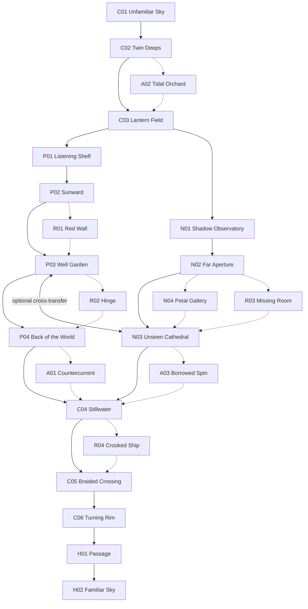

# Expedition in 3D — S4

**Status:** A6 and A8–A13 are owner direction ([decisions](../DECISIONS.md)); names, volumes, ranges, pacing and build order below are **[ASSUMED] recommendations**, not new approvals. This replaces 1F's planar, fixed-layout branch loops. All twenty original IDs and engineering questions remain, with three optional additions. No route is demonstrated playable by this study.

Recommend the full forward expedition, with substantial places containing smaller investigations, and a physical wells-plus-lattice passage at Braided Crossing. Build the core route before committing to new physics. The [region pages](regions/) use the [encounter template](encounter-template.md); its old planar-control sentence is superseded by A11. The [S4 study register](../studies/S4/README.md) details implementation, conflicts, costs, tests and owner choices.

## Route graph

These are author-known connections, not an already revealed map. Names become chart labels after sensed leads are identified. Arrows describe travel opportunities, not teleport buttons or invisible one-way walls.

| Detour | Entry → investigation → forward rejoin | Useful unresolved question |
|---|---|---|
| Tidal Orchard | C02 → A02 → C03 | Engine-off attitude drift; only **after** the required Beta flyby/belt exit |
| Red Wall | P02 → R01 → P03 | Cooling over the needed duration |
| Hinge | P03 → R02 → P04 | Well-boundary timing |
| Petal Gallery | N02 → N04 → N03 | Repeated views and connected space |
| Missing Room | N02 → R03 → N03 | Weak reconstruction versus clear space |
| Countercurrent | P04 → A01 → C04 | Net propellant benefit from gas braking |
| Borrowed Spin | N03 → A03 → C04 | Capture, load and release for useful momentum exchange |
| Crooked Ship | C04 → R04 → C05 | Present configuration's turn authority and clearance |

The optional P03 ↔ N03 transfer supports either signature order without repeating a region:

- Power first: C01–C02–C03–P01–P02–P03–N03–C04–C05–C06–H01–H02.
- Sensing first: C01–C02–C03–N01–N02–N03–P03–P04–C04–C05–C06–H01–H02.

It joins outgoing and incoming observation skirts. A correlated distant glimmer, then a second bearing, charts it; no quest arrow appears after branch completion. Both directions need supported arrival envelopes and a real connecting flight carrying the actual ship. Forward routes need the transfer at most once; no visited-node restriction prevents voluntary retracing.

There is **no C03 → C04 outer bypass**, and no required return from Stillwater to Lantern Field. A one-branch player can reach C05, learn a shortfall and Recall; the next run can take the other branch. A player already carrying both lessons may choose either branch. Equivalent evidence, including local experiments, counts; visiting both branches never unlocks a gate.

## Volumes and pockets

[ASSUMED] Twenty-three entries need twelve core authored volumes and two optional new-system volumes, not twenty-three rooms. IDs below are authoring keys, not new game contracts. Shared sectors retain one world state and clock.

| Volume | Distinct authored place | Regions and pockets |
|---|---|---|
| V00 | Open arrival expanse | C01 safe preparation and deliberately entered departure trial |
| V01 | Twin Deeps binary and belts | C02; A02 downstream pocket beyond the required exit |
| V02 | Lantern formation and shoulders | C03; P01 and N01 are different observation pockets at the branch mouths |
| V03 | Sunward body and illuminated limb | P02; R01 thermal pocket; P04 later far-side eclipse sector, not a repeat visit to P02 |
| V04 | Well Garden | P03; R02 downstream boundary pocket |
| V05 | Far Aperture baseline | N02 ordinary occlusion/bearing volume; its name does not require system X |
| V06 | Petal cluster | N04 distinct optional observation volume; tiny openings, no ship shortcut |
| V07 | Unseen Cathedral | N03; R03 approach gallery reached from N02 before the main traverse |
| V08 | Stillwater expanse | C04; R04 deliberately entered maneuver pocket |
| V09 | Braided Crossing | C05 combined well, debris and lattice transfer |
| V10 | Moving homeward rim | C06 standoff and H01 commitment are phases of the **same** opening |
| V11 | Earth-side space | H02: the reveal through the window (A17); no flying task |
| V12, optional | Countercurrent streamer | A01; gas physics is not implicit in V03's eclipse |
| V13, optional | Borrowed Spin structure | A03; proposed tether hardware/dynamics |

Pockets share host mass, radius, identity, phase and evidence. Starting a new encounter must not duplicate a body or restore a ship. A02 can reuse Beta's geometry but still needs a new distributed-gravity coupling. Quiet locations do not freeze time; committing to an experiment can create local pressure.

### Continuity and preparation

[ASSUMED] Use the local inertial frames in `src/contracts/README.md`, measured connector transforms and truly 3D placement. A forward route need not be spatially straight. A3 supplies one distant sun: rotate geometry relative to that common direction, not a newly randomized sun in every pocket. Brightness is an authored constant pending P14. Current shadows use massive-body cylindrical occlusion; decorative slab gaps cannot promise unbuilt mesh shadows.

[ESTABLISHED: DECISIONS A12] All visible screens, comparisons, rule fitting, room walking and configuration changes continue at ≥1× inside encounters. Alerts drop warp to 1×. Hidden-page hold permits no observation or edits. No tactical HOLD, slow motion or forecast modal stops flight. Verify MAP, SHIP, CONSOLE and the room as well as FLIGHT.

[ASSUMED] Ordinary transfers offer a clear illuminated coast and sustainable low-load preparation configuration: no station-keeping burn, adequate generation and stable temperatures. This is the implementation target for A12's unlimited preparation, not a consumption exemption. Current damage may make a particular operation unsustainable; telemetry exposes that before entry. Entering an eclipse, well, lattice, gas pass, tether capture or finite-window approach is an explicit commitment. P04's battery challenge belongs inside its encounter. Proving sustainable preparation with current RCS use, aging, power and thermal behavior is an **unresolved dependency**.

[ASSUMED] Keep one monotonic run clock T and record encounter epoch T₀, with local t = T − T₀. Author seeded worlds at the run epoch and advance deterministically to observation/arrival; shared volumes evolve when unseen. Preserve the materialized world on voluntary revisits. Never restart a rim phase on detection, reseed a pocket or replace arrival velocity with a tutorial state. Save/load resumes the same run. Every transfer integrates resource use and calibration aging; boundaries never repair, refill or clear heat.

## Braided Crossing: both lessons without explanatory text

[FICTIONAL] W reverses radial **propulsion response**, not velocity, gravity or tangential thrust. L produces cumulative component exposure near strands; powered processing on existing hardware reconstructs acquired observations. C05 combines these unchanged rules, with no new “braid force.”

[ASSUMED] Arrange a broad approach skirt, a well-conditioned change of velocity, then offset lattice openings requiring that velocity and a timed configuration change. Entrance and exit lack a straight coast axis. Obstacles, finite fields, velocity constraints and actual reserves must make avoiding either task infeasible within the supported arrival envelope. No invisible shell or knowledge lock. An unexpected physically valid solution stays valid; if it routinely bypasses a lesson, revise geometry openly after the harness result.

| Arriving with… | Observable shortfall | Evidence pointing toward the missing branch |
|---|---|---|
| Wells, little lattice evidence | Optical rocks look passable, but the inactive channel leaves unsampled volumes. A powered sample reveals a strand across the appendage sweep; a shallow glance can trip an exposed component. | Allocation, coverage, component telemetry and frozen forecast show that “empty” was unsupported. Retained sensing-lead bearings and similar channel traces give a direction next run. |
| Lattice, little well evidence | Clear centers are reconstructed, but a small radial burn gives opposite track residuals while coasting and tangential burns remain consistent. | Burn tick, measured trail and frozen forecast separate. Archived power-branch glimmers remain available. The model never automatically invents the reversal rule. |
| Both lessons | Boundary positions, tilt, incoming momentum, folding time, loads and control condition differ. | Fresh measurements support a current-state procedure; archived successful commands are not automatically retimed. |

The same instruments exist before C05. Comparison selects the earliest **recorded** lost margin, not an omniscient death explanation. Graphs and 3D overlays carry the lesson, using equipment labels and units, without “visit the other branch” prose. No death, damage or visit-count unlock. An attentive newcomer may probe safely, learn manually and finish a zero-loss run. Validated model adoption additionally needs independent held-out records: the current model requires different AttemptIds, so splitting same-run experiments without resetting physics needs the record-boundary change requested in the study register. Until that exists, a second segment of one AttemptId must not be called a passing held-out test. More often a one-branch novice aborts or fails, then chooses the other branch on a later run. Recall restarts the whole expedition. Blind success remains possible and earns only observations actually acquired.

Verify wells-only, lattice-only, neither-informed and both-informed arrivals; scripts cannot establish human comprehension, so owner playtests must test the branch inference without prose. Both cross-transfer arrivals require roll-held solutions and observable abort margins before commitment.

## Fixed and varied

| Fixed across runs | Seeded geometry / evolving state |
|---|---|
| Route structure, region identities, component inventory, laws and response families | Initial positions, orbital/spin phase, allowed orientations, viewing baselines, obstacle placement and approach direction within authored ranges |
| Every massive body's mass and size, with shared identity across pockets | Relative illumination from geometry and subsequent deterministic eclipses/motion |
| P4: a = (GM/r₀²)(r₀/r)^2.5; shared r₀ = 1,000 km | Ship and asteroid trajectories in that same 3D law |
| Twin Deeps: GM Alpha 1×10¹⁰, Beta 2.5×10⁹ m³/s²; radii 250/160 km; recommended fixed 4,000 km circular separation (P16 baseline) | Binary phase/orientation, belt phases/inclinations and supported arrival geometry; **no mass-ratio or radius draw** |
| Required C02 exit: slingshot past moving Beta through its orbiting asteroid belt (A6) | Fresh moving-rock clearance and outgoing geometry; A02 cannot bypass it |
| Adopted rules, acquired evidence, original forecasts, procedures and lead identities | New-run sensor noise; current measured bearings, ship condition and calibration uncertainty |

[ASSUMED] Initially keep well dimensions/profile, lattice exposure law, opening shape/kinematic family, gas profile and tether mass/inertia fixed; vary placement and phase rather than hidden strength. This deliberately narrows the earlier proposal until geometry alone proves sufficient. Page ranges are **candidate generation envelopes**, not independent knobs: reject combinations failing clearance, observability, roll-held control, abort or resource checks. Do not secretly increase difficulty after learning.

Randomness belongs to `src/lib/rng.ts` named streams, proposed as `expedition.<volume>.geometry` and `expedition.<region>.sensors.<device>`, rooted in the run seed. Branch choice must not change another branch's draws. Record run seed/content version in truth-side saves and each sensed arrival in `AttemptStart.briefing`; the model never reads the seed to reconstruct unseen obstacles. Preserve acquisition order. A replay of the same record is not independent held-out evidence. This study implements no generator.

On loss/Recall, Black Box keeps acquired records up to loss, original forecasts, rule tests/adoptions, procedures and charted leads; belief rebuilds from them. Old positions remain archival, not today's obstacle map. Stable body IDs preserve local calibration; A5 shared-law validated radial spans transfer, while new tracking remains necessary. Ship calibration loosens by recorded time/use/damage. Only recurrence resets the physical ship/worlds, with the next run's geometry.

## Pacing estimates

[ASSUMED] Active minutes mean wall-clock observation, decision and operation, including short transfer work at chosen warp. They exclude arbitrary preparation breaks, reloads and previous failed runs. They are not simulated flight minutes: long coasts still consume modeled resources. First-run numbers assume useful exploratory comparisons; an actual first-ever run may end at C02 or C05.

| ID | Region | First exploratory minutes | Practiced minutes |
|---|---|---:|---:|
| C01 | Unfamiliar Sky | 2–3 | 0.5–1 |
| C02 | Twin Deeps | 8–12 | 3–5 |
| C03 | Lantern Field | 2–3 | 0.5–1 |
| P01 | Listening Shelf | 3–5 | 0.5–1 |
| P02 | Sunward | 4–6 | 1.5–2.5 |
| P03 | Well Garden | 6–9 | 2–3 |
| P04 | Back of the World | 3–5 | 1–2 |
| N01 | Shadow Observatory | 3–5 | 0.5–1 |
| N02 | Far Aperture | 3–5 | 1–2 |
| N03 | Unseen Cathedral | 6–9 | 2–3 |
| N04 | Petal Gallery, optional | 4–7 | 0.5–1.5 |
| C04 | Stillwater | 2–4 | 1–1.5 |
| C05 | Braided Crossing | 5–8 | 3–4 |
| C06 | Turning Rim | 3–5 | 1–2 |
| R01 | Red Wall, optional | 3–5 | 0.5–1 |
| R02 | Hinge, optional | 3–5 | 0.5–1 |
| R03 | Missing Room, optional | 3–5 | 0.5–1 |
| R04 | Crooked Ship, optional | 2–4 | 0.5–1 |
| H01 | Passage | 4–6 | 2–3 |
| H02 | Familiar Sky (the ending, A17: the loss sequence, then Earth in the window) | under 1 | under 1 |
| A01 | Countercurrent, optional | 4–7 | 2–3 |
| A02 | Tidal Orchard, optional | 3–5 | 1–2 |
| A03 | Borrowed Spin, optional | 6–10 | 3–5 |

The [checker](../../tools/studies/S4/check_design.py) sums these assumptions and checks graph consistency. Arithmetic is not timing/playability evidence. Representative routes:

- First power-first exploration: C01–C02–C03–P01–P02–R01–P03–N03–C04–R04–C05–C06–H01–H02: **12** entries through C06; **46–73** minutes to contact, **52–82** through Earth arrival.
- First sensing-first exploration: C01–C02–C03–N01–N02–N04–N03–P03–R02–P04–C04–R04–C05–C06–H01–H02: **14** through C06; **52–84** minutes to contact, **58–93** through Earth arrival. Neither example needs new physics.
- Practiced sensing-only: C01–C02–C03–N01–N02–N03–C04–C05–C06–H01–H02: **9** through C06; **12.5–20.5** minutes to contact, **15.5–25.5** through Earth arrival, with both hazard lessons retained.

The short power-only route has ten entries through C06. Thus the brief's twelve-to-fifteen first-contact intention fits exploratory routes, **not every A13 path**. Do not pad counts, force detours or hide an earlier physical exit sighting. Answered investigations become skippable; their host flight still needs fresh geometry and execution. On run ten the belt/flyby, well boundaries, lattice clearances, coupled C05 sequence and H01 tail-clearance window stay dangerous. Quiet preparation remains quiet under A12; no universal countdown.

## Dependencies and recommended build order

| System | Content | Dependency |
|---|---|---|
| D/E/S: 3D motion, ship operation, measurement | All | Existing foundations; 2G conversion and 2D/2F integration still underway at S4 baseline |
| W: local propulsion response | P03, R02, C05 | Unbuilt; S5 → 3B; no overlapping wells without an approved composition rule |
| L: exposure and acquired reconstruction | N03, R03, C05 | Unbuilt; S5 → 3C with 3A component damage/full-ship sweep |
| X: paired views/finite moving transfer | N04, C06, H01, H02 | Unbuilt; S6 → assigned X owner/4D; partial crossing, moving frames, Earth-side dynamics unresolved |
| Gas coupling | A01 | Drag/loading/heating/measurement absent; feasibility and ownership first |
| Distributed gravity | A02 | Extended-body torque absent; prove observable magnitude without amplification |
| Tether system | A03 | S1/S2/S3, hardware, capture/loads/release and belief support first |

All core corridors must admit yaw/pitch with roll held and supported deployment. Lantern's rear glimmer uses a slew/map view; Sunward's rolled light-catching moment becomes a yaw/pitch trade; C05 uses folding/approach geometry. Optional roll-only variants are deferred. The [study register](../studies/S4/README.md) and every region page identify remaining roll risks.

Recommended order: **2G + 2D/2F baseline → sustainable transit + whole-run persistence + harness → W/L and ship depth → both branches/cross-transfer arrivals → C05 → shared X → Petal/Turning Rim/Passage/Earth → full-route balance.** Investigate X feasibility early in parallel, before branch polish. Prototype Borrowed Spin in an independent optional lane once S1–S3 support it; gas and tidal torque remain separate owner choices. A smaller version can defer A01–A03 and optional pocket polish while keeping all core A13 connections and both signatures. It loses those investigations, not an approved branch or homeward payoff.

Owner review: volume/pacing allocation, shared X behavior from S6, optional-system investment, and Earth approach/contact scope, one decision at a time. This study does not edit decisions, contracts, source, screens or implementation assignments.
