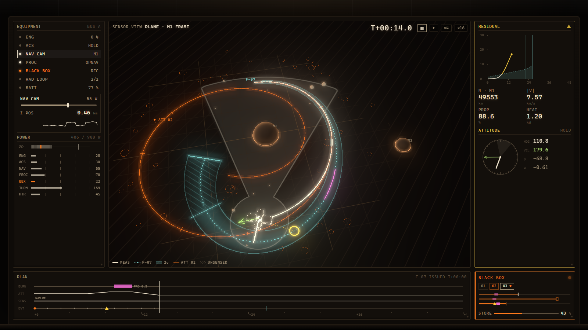
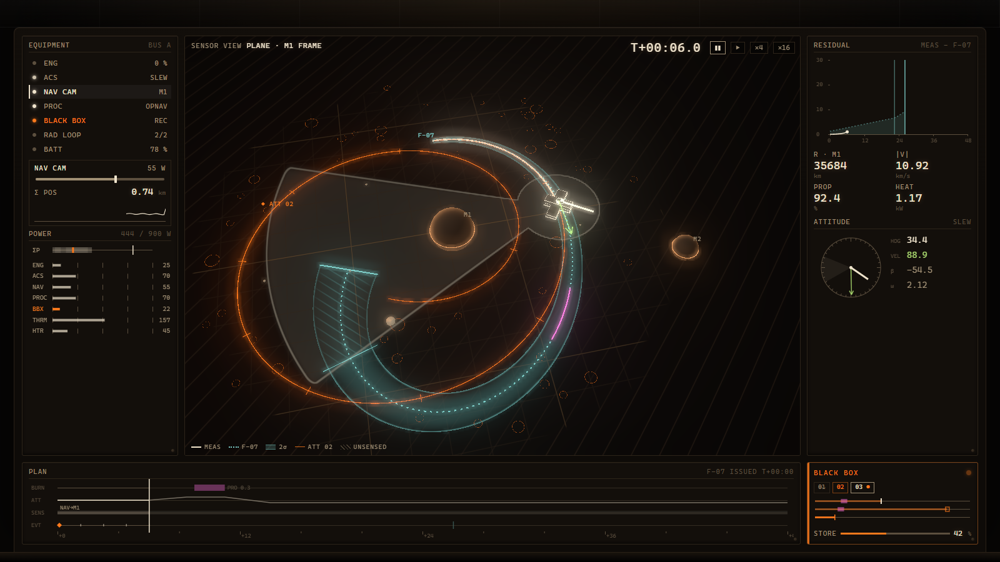
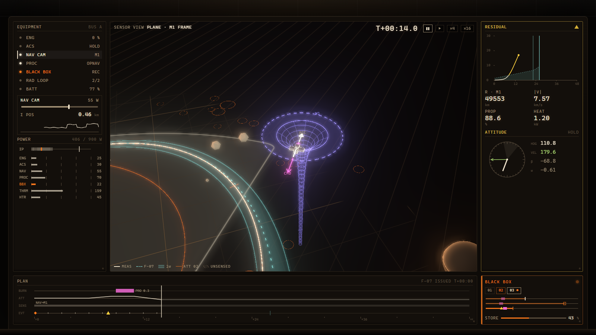
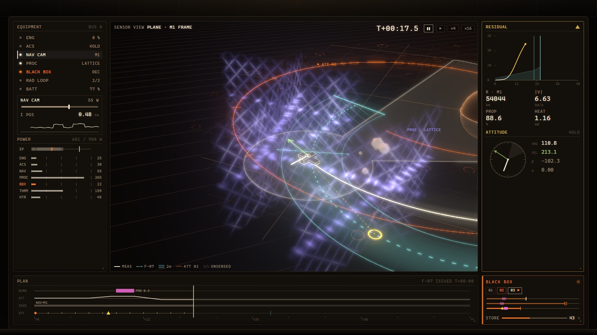
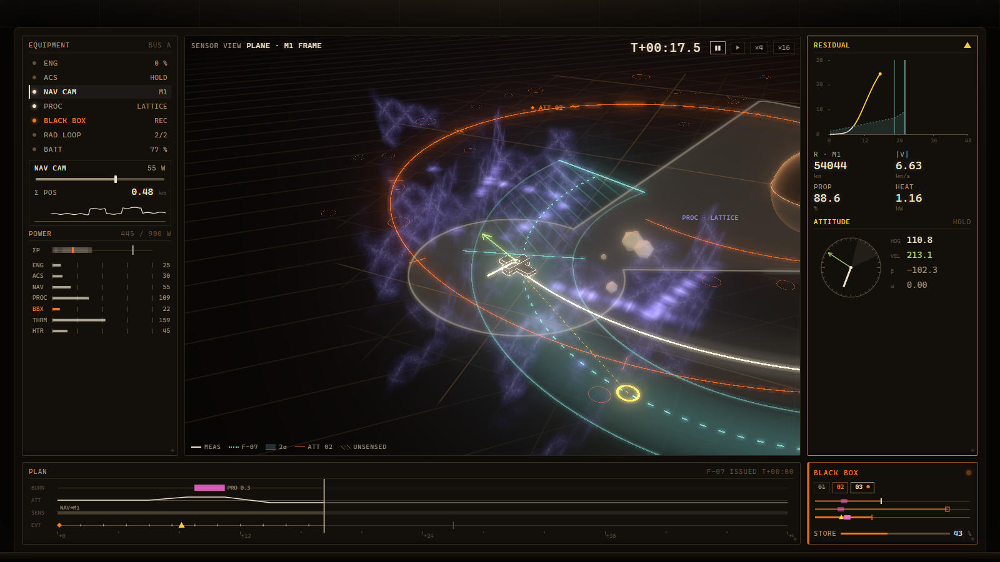
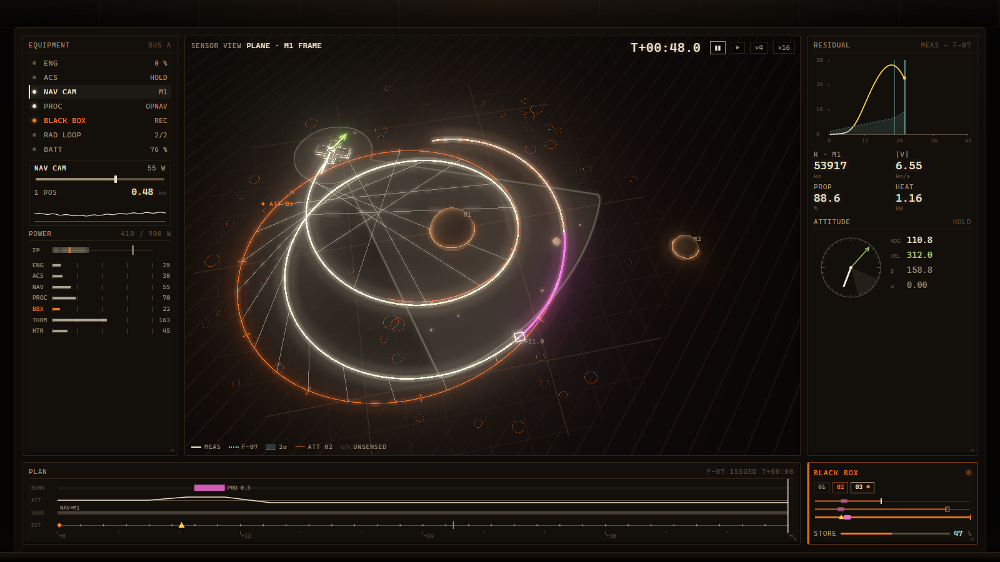
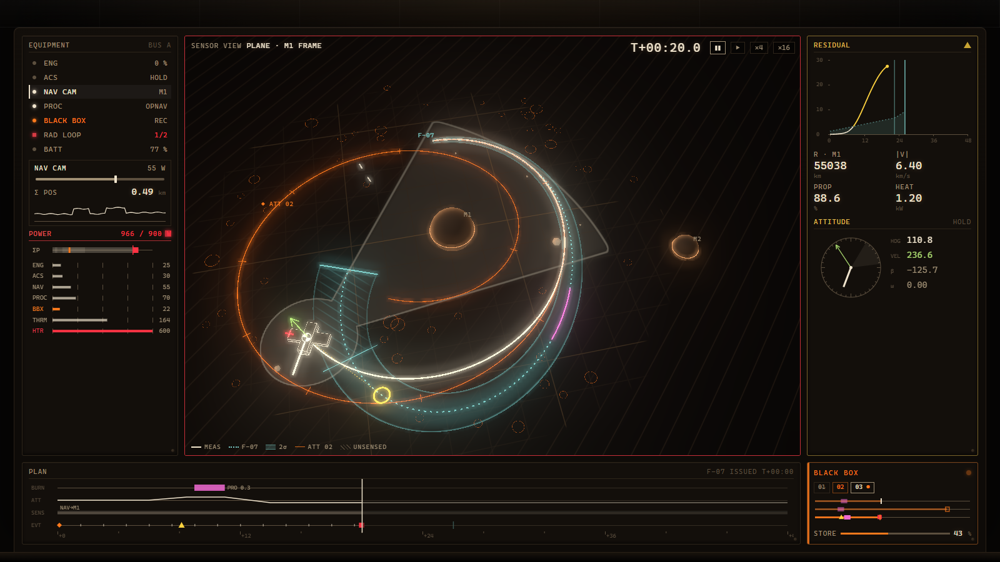

# Visual direction: Night Watch

Owner: 1E, the UI lane. Tokens: `src/theme/`. Running reference: `prototypes/visual/` (see [How to run](#how-to-run-the-prototype)).

**Status.** The owner chose Night Watch on 2026-11-14 from three running directions. Their words: they really like Night Watch *as a theme*, but the player's in-game view will not look like the prototype's panel layout; that is still to come.

So this document fixes **how things look**: palette, type, materials, line language, motion and the rendering rules below. It does **not** fix screen layout or scene composition. The prototype's panel arrangement is a test bench for instruments, nothing more. Layout belongs to 2D/3F (console) and 2E/3F (view), and the owner has not decided it yet.



## 1. The direction in one paragraph

A dark-adapted flight deck at night. Warm near-black surfaces, warm ink, a soft phosphor glow on lines and numbers, one monospace face. Reality (what was measured) is drawn in warm ink; prediction (what the model said) is drawn in a cool teal, so the two never blur together. Black Box is international orange, like a real flight recorder, and everything it carried across recurrence wears that colour. The console is fitted hardware (bevels, a screw head per module), not floating glass. Nominal is quiet: when all is well nothing glows except live data and the Black Box lamp ("dark cockpit"). [ASSUMED: owner-approved look]

Alternatives shown and not chosen, kept for the record: [A Night Watch](img/round1-a.png) (chosen), [B Deep Field](img/round1-b.png) (cool glass, strong glow, ship-centred range rings), [C Survey Plot](img/round1-c.png) (matte drafting table, ink lines, no glow).

## 2. Palette

Tokens in `src/theme/colour.ts`. Names are roles. Use the role that means what you are drawing, never a colour because it looks right.

| Role | Hex | Means | Rule |
|---|---|---|---|
| `room`, `table`, `panel`, `panelEdge`, `tableEdge`, `tableLip` | `#060504` … `#2d2419` | Compartment and console | Warm near-blacks. No pure black except the 3D view clear colour family (`viewBackground #080605`). |
| `ink` | `#efe3cc` | Primary text, hull edges | About 15:1 on `panel`. |
| `inkDim` | `#a08f74` | Secondary text | ≥ 4.5:1 on `panel` (tested). |
| `inkFaint` | `#5c4f3e` | Units, axis ticks, rules | Decorative only. Never the sole carrier of information. |
| `measured` | `#f3e6cc` | What happened: trail, ship, body axis, CoM | Same family as ink: reality is the ink of the display. |
| `forecast` | `#79c9c4` | What the model predicted: issued forecasts, envelope, forecast-now mark | The only cool hue in the base set. Prediction is cool, reality is warm. |
| `velocity` | `#a8d86e` | Velocity vector | Never on anything else. |
| `thrust` | `#f06ad2` | Commanded thrust: line of action, chevron, planned burns | Never on anything else. |
| `blackbox` | `#ff7a1c` | Anything Black Box preserved or issued: earlier attempts, prior evidence, issue marks, the recorder | International orange. Not an alert colour. |
| `advisory` | `#efe3cc` + ○ | Awareness only | |
| `caution` | `#ffd23f` + ▲ | Needs attention soon | |
| `warning` | `#ff3344` + ■ | Needs action now | Crimson, pushed away from Black Box orange. |
| `well`, `lattice` (`latticeCore #ece6ff`) | `#9b8cff` | Fictional phenomena | Violet, the one hue nothing physical uses. |
| `grid`, `gridMajor`, `unknown`, `coverage` | | Flight plane and coverage | See § 6.2. |
| `body`, `bodyRim`, `asteroid`, `hull`, `hullEmissive` | | Materials | See § 4. |

Rules:
- **Colour never works alone.** Every alert has a shape (○ ▲ ■); every data hue also differs in line style (dotted forecast, solid trail, thin velocity with open head, dashed thrust line). [ESTABLISHED: DD01, V2 10045 colour-coding redundancy]
- **Alert colours mean alerts only.** Caution yellow and warning red never decorate data. [ESTABLISHED: DD01, V2 10114 distinct, consistent annunciation]
- The warm hues are crowded (Black Box orange, caution yellow, warning red, body rim). `src/theme/theme.test.ts` keeps them apart (ΔE76 > 20 for every pair that must not be confused) and checks text contrast. Run it after any palette change.

## 3. Typography

Tokens in `src/theme/type.ts`. One face: **Cascadia Mono** with Consolas / SF Mono / Menlo fallbacks. System fonts only; nothing to download. [ASSUMED]

| Use | Size | Treatment |
|---|---|---|
| Axis ticks, units, 3D tags | 10 px | `inkFaint` / `inkDim` |
| Labels | 11 px | Uppercase, tracking 0.08 em, `inkDim` |
| Body | 12 px | |
| Value in a detail block | 15 px | Tabular figures |
| Readout | 18 px | Tabular figures, faint glow |
| Mission elapsed time | 20 px | One per screen |

Labels are terse codes (`R · M1`, `PROP`, `NAV CAM`), never sentences. Numbers always use tabular figures so they do not jitter.

The labels sit below NASA's crew-label minimum of 12 pt / 0.4° at the operating position, deliberately, for density on a desktop screen. [ESTABLISHED: DD01, V2 10066] [ASSUMED: acceptable for a game] If the owner presents on a projector, raise `type.size` one step.

## 4. Materials and lighting

**Compartment.** A dim warm room: one soft overhead light pool (`roomLight`), faint bulkhead seams above the table, a table lip in front. The console sits in it as a physical object. (How much of the compartment the player sees is a layout decision, not made yet.)

**Console modules** (`src/theme/space.ts`): 3 px radius, inset bevel (`surface.panelInset`), 1 px `panelEdge` border, a small screw head bottom right. Modules are fitted hardware, not translucent windows.

**3D sensor view** (`src/theme/render.ts`):
- Clear colour `viewBackground`; exponential-squared fog (`fogDensity`) into it.
- Bloom: strength 0.55, radius 0.35, threshold 0.12. A phosphor glow on bright lines, never a haze over the scene.
- Massive bodies: dark warm sphere, one key light, fresnel rim in `bodyRim`. Their intersection with the flight plane is drawn as a thin ring (their footprint in the plane).
- Ship hull: dark Lambert (`hull`) with `measured` edges at 0.8.
- Asteroids: low-poly flat-shaded rocks in `asteroid` with slight emissive.

## 5. Instruments

What exists in the prototype, as the style reference for `src/theme/components/` (Part 2 builds them as React primitives):

- **Panel header:** label left, secondary code right in `inkFaint`, 1 px rule beneath. Alert glyph sits at the right end of the header.
- **Readout:** label above, 18 px number, unit small and faint.
- **Trace (strip chart):** time on x; measured trace in `ink` 1.6 px; reference band (e.g. forecast 2σ) as a filled `forecast` area at 14 % with a dotted edge; vertical bars mark the knee and horizon; the part of a trace that breaches its band switches to `caution`.
- **Bar gauge (power):** total-versus-supply bar with a supply tick; loads as rows; a load is coloured only when it means something (Black Box draw in `blackbox`, engine in `thrust` while burning, overdraw in `warning`).
- **Attitude rose:** body axis heavy `ink`, velocity thin `velocity` with an open head, sensor sector as a faint wedge, thrust as a short `thrust` bar aft while burning.
- **Equipment row:** status pip (off `inkFaint`, on `ink`, thrusting `thrust`, fault = a square `warning` pip), code, value.
- **Black Box unit:** see § 6.9.

## 6. Rendering semantics

These are the rules the game depends on. Each is running in the prototype. [DEMONSTRATED: prototypes/visual, screenshots in `img/`]

### 6.1 Forecast, trail and envelope (P10, P6)

- **Issued forecast:** the predicted centre-of-mass path, **dotted** `forecast`, drawn exactly as issued and never redrawn (frozen). It **stops at its horizon**, marked by a short bar across the envelope. Nothing is drawn past the horizon.
- **Planned burns** appear on the forecast as short solid `thrust` segments.
- **Measured trail:** **solid** `measured`, 2.4 px, grows as the ship flies.
- **Envelope:** a band of half-width 2σ around the forecast, `forecast` at low opacity with brighter edges. Where the forecast leaves sampled space (sample `extrapolating`), the band **widens faster and turns hatched** (−45°). A short bar marks the knee. Hatching always means "not measured" (the same language as unsensed space).
- **Forecast-now mark:** a small `forecast` ring where the forecast placed the ship *now*, joined to the ship by a thin dashed link. When the ship is outside 2σ, ring and link switch to `caution` and the residual instrument raises ▲.
- Forecast labels are short ids (`F-07`). The issue moment is marked with a Black Box ◆ on the timeline.



### 6.2 Sensor coverage

The flight plane shows three states, never filled in:

| State | Look |
|---|---|
| Sensed **now** (inside a `SensorSector`) | Full grid, faint `coverage` tint, thin `coverage` edge on the sector boundary |
| Sensed **earlier** (this attempt, or an earlier attempt via Black Box) | Grid at 42 % |
| **Never** sensed | No grid. Faint 45° hatch in `unknown` |

Objects follow what the ship knows:
- **Tracked** (in coverage now): solid rock.
- **Stale** (seen earlier this attempt): a ring on the plane at the last fix; its radius grows with position uncertainty and its opacity fades to a floor. [ESTABLISHED: DD01, V2 10020 stale data must be indicated]
- **Prior** (known only from an earlier attempt's record): a ring in `blackbox` at 30 %.
- **Never sensed:** not drawn at all.

### 6.3 Ship: footprint, centre of mass, axes, velocity

Four different quantities, four different marks (brief §10):

| Mark | Look |
|---|---|
| **Footprint** | The configuration's outline (`ShipView.footprint`), drawn on the plane in `measured` at 55 %. This is what clearance is measured against. |
| **Centre of mass** | The quartered-circle engineering symbol, flat above the hull. |
| **Body axis** | A short **heavy** (3 px) solid tick from the CoM through the nose. |
| **Thrust** (`ThrustTick`) | The **line of action**: a dashed `thrust` line through the application point, plus a solid chevron behind the engine pointing in the force direction. Shown while thrusting; at 35 % in the 2.5 s before a planned burn. Because it is drawn through the application point, a line of action that misses the CoM shows the torque. |
| **Velocity** | A **thin** `velocity` vector from the CoM, length proportional to speed, open arrowhead. World frame, not body frame. |

**Symbol scaling:** the ship is drawn at true size up close and enlarged (up to 4×) as the camera pulls back so it stays legible. It is **never** shrunk. In any hazard that depends on clearance (lattice, close passes) the view must be at true scale when the player judges clearance; 2E should drop the enlargement when the camera is close enough for the true footprint to read.

### 6.4 The flight plane in 3D (P1)

Flight is planar; the view is 3D. Depth cues, in order of importance:

1. **Plane veil:** the plane is 45 % opaque `viewBackground`, so anything below it reads as *below*. Render order: below-plane structures (−20), plane (−10), envelope (1), on-plane marks (2), above-plane (4), ship marks (5).
2. **Fog** into `viewBackground`, and the grid fades out toward the plane's edge.
3. **Plane footprints:** massive bodies show their intersection ring with the plane.
4. **Depth staff:** structures below the plane get a dotted vertical axis with a tick every 10 units.
5. **Default oblique view** at 55° elevation; orbiting allowed, damped (0.08).

### 6.5 Wells (brief §7) [FICTIONAL]



Long, narrow funnels hanging **below** the plane, drawn as contour rings that tighten toward a long throat, plus meridians, in `well` violet, dimming with depth and seen through the plane veil. On the plane: the **mouth** (solid ring) and, more important, the **response-reversal boundary** (dashed ring, faint violet interior), because entry and exit matter. The specimen shows the rule's evidence the way the player would see it: commanded thrust outward (`thrust`), measured acceleration inward (`measured`, filled head).

### 6.6 Lattice reconstruction (brief §6) [FICTIONAL]



Overlapping vertical sheets of diamond mesh (chain link), additive `lattice` violet: **intense on the strands, falling to clear centres** (exponential falloff from the nearest strand), strand cores going to `latticeCore`. Where a sheet cuts the flight plane it is drawn as a **bright strip**: that strip, with its gaps, is what the ship must thread. Sheets extend above and below the plane, split at the plane so the lower half sits under the veil.

**Reconstruction quality follows processing power:** at low power the sheets are patchy, grainy and their strands blurred (strand width up to 3×); at zero power nothing is drawn, because the ship then knows nothing. The reconstruction is a Black Box processing product on existing sensors, so the equipment row reads `PROC · LATTICE`.



### 6.7 Two-attempt comparison



- Current attempt in `measured`, the earlier one in `blackbox` (it is a Black Box record), each with time ticks every 5 s.
- Thin `ink` links join the two at **equal times** every 2 s, so "where was I at the same moment" reads at a glance.
- **What changed:** each attempt's burns drawn in `thrust` on its own path.
- **First divergence:** an open diamond with `Δ T+11.0`.
- Forecasts are hidden by default in this view; if shown, each keeps its own attempt's colour family, dotted.

### 6.8 Restrained feedback



| Event | Treatment |
|---|---|
| Advisory | `advisory` ○ on the relevant module. |
| Caution | The module's border and header turn `caution` over 300 ms with ▲; the offending trace segment turns `caution`. Then steady. |
| Warning | Header and rule turn `warning` with ■; the offending quantity is drawn in `warning` (e.g. overdraw beyond the supply tick). Then steady. |
| Damage | The hull and footprint flicker `warning` twice (60 ms on/off), the sensor view frame takes `warning` for one beat (300 ms), then a **permanent** `warning` notch stays on the struck edge and the affected equipment pip becomes a red square. |
| Success | The objective gate closes, a thin ring expands and fades, and the measured trail brightens once and settles (600 ms). No banner. |

Every event also lands on the Black Box tape and the plan's event lane as its glyph. No explanatory prose anywhere, no blinking, no full-screen flashes, no shake. If several alerts are active, the highest level wins the shared surfaces (view frame, table edge). [ESTABLISHED: DD01, V2 10114, V2 10175 alert prioritisation]

### 6.9 Black Box presence (brief §3)

Black Box is part of the ship, not a narrator:
- **The recorder unit:** an orange-edged module with its name plate, a record lamp that breathes slowly (2.4 s, the one ambient animation), the attempt cells (`01` lost, struck through; `02` recalled, orange; `03` now, ●), a tape of the current attempt with burns and event glyphs written as time passes, and storage used.
- **Its colour on evidence:** earlier attempts' paths, asteroids known only from earlier attempts, and the ◆ that marks an issued forecast. Orange means "Black Box carried this".
- It never speaks in sentences, never points at answers, never animates to draw attention.

## 7. Motion

Tokens in `src/theme/motion.ts`.

- Hover / select 120 ms; panel state 200 ms; alert fade-in 300 ms; success settle 600 ms; camera moves 450 ms; easing `cubic-bezier(0.2, 0, 0, 1)`.
- Nothing loops except live data and the Black Box lamp.
- Alerts appear once and stay; they do not blink. Damage is the only flicker, and it is two cycles.
- Time warp speeds up the world, never the interface.
- Display motion must be smooth, without jitter or ratcheting. [ESTABLISHED: DD01, display latency rationale]

## 8. What to avoid

- Explanatory prose, tooltips that explain the physics, banners ("Gravity anomaly detected!").
- Filling in what the ship has not sensed, smoothing a forecast after the fact, or drawing anything past a forecast's horizon.
- Using `caution`/`warning` for decoration, or `blackbox` for anything Black Box did not carry.
- One mark for two quantities (velocity drawn as heading, thrust drawn as body axis).
- Glow as atmosphere: bloom is for bright lines only.
- Blinking, shaking, full-screen flashes, countdown clocks (brief §10: no universal countdown).
- Hard-coded colours, sizes or timings anywhere outside `src/theme/` (Convention 11).

## 9. For the console and view threads

- `src/theme/index.ts` exports `colour`, `opacity`, `type`, `space`, `surface`, `line`, `dash`, `hatch`, `motion`, `render`, `cssVariables` (for the console root) and the 3D style table (`lineStyles`, `envelopeStyle`, `planeStyle`, `objectStyle`). `hex()` turns a token into a Three.js colour number.
- Contract mapping (`src/contracts/view.ts`): `trail` → `lineStyles.trail`; `forecasts[].samples` → `lineStyles.forecast` + `envelopeStyle` (`positionCov` → 2σ half-width, `extrapolating` → hatched); `ship.footprint`, `ship.centerOfMass`, `ship.thrust` → § 6.3; `coverage.sectors` → § 6.2 (sector `quality` can scale the tint); `compare` → § 6.7; `world.asteroids[].tracked` and last fix → tracked / stale.
- Handedness: the contracts use counter-clockwise angles from +x. With Three.js y-up, map game (x, y) to (x, 0, −y) so the view from above is not mirrored. (The prototype uses (x, 0, y); it does not matter there.)
- Dashes: tokens are screen px; scale `LineMaterial` dashes with camera distance so the forecast keeps its rhythm.

## How to run the prototype

```bash
node prototypes/visual/serve.mjs
```

Then open http://localhost:5180/. Keys: `1`–`5` scenes (flight, wells, lattice, compare, feedback), space pause, ←/→ scrub, drag to orbit, `f` refit, `v` view only, `h` hide the prototype bar. URL parameters for screenshots: `s` scene, `t` time, `pause=1`, `chrome=0`, `view=1`, `pw` lattice power, `fx=warning,damage`. Three.js 0.170.0 loads from jsDelivr; the game itself pins 0.187.0. The flight is a toy (true world inverse-2.5, forecast Newtonian) and panel numbers are illustrative.

## Sources

- DD01: NASA Crew Interfaces (NASA-STD-3001 Vol. 2, ch. 10): V2 10020 stale/missing data indication, V2 10045 colour-coding redundancy, V2 10066 label font height, V2 10114 distinct alert annunciation, V2 10175 alert prioritisation, V2 10171 decision-aid limitation notification (the envelope and horizon are how the forecast says "beyond what I know").
