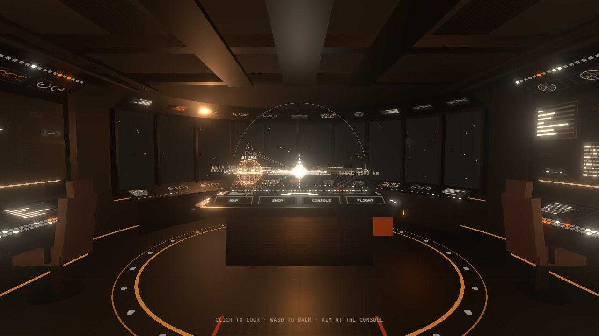
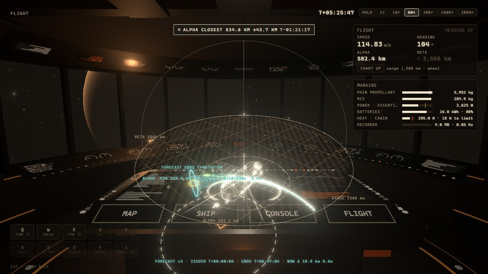
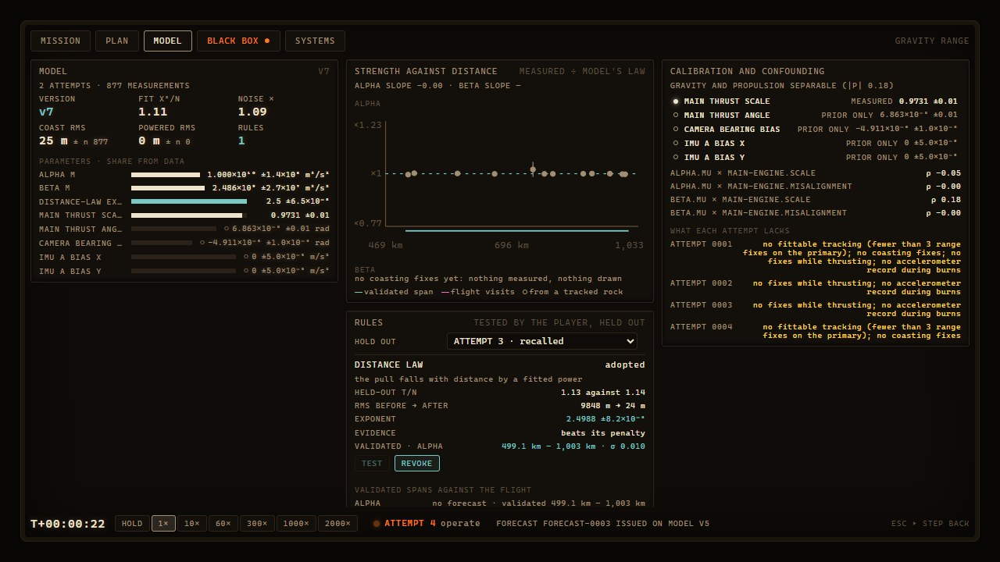

# Handoff: 2D — Control room and every screen

Thread: Claude (Fable) · Branch: `p2/2d-control-room` (worktree `.worktrees/2d`) · Date/time (Pacific): 2026-11-14 15:45 PST

**Interim.** The control room is the game's screen, on the live simulation, ship, model and Black Box. The learning loop at Alpha plays in it end to end. Still to come on this branch: the switch to 2G's 3D contracts when its lift reaches main (proved on a scratch branch, below), the slingshot objective and belt when 2G's step 5 lands, the owner's answers to the open questions below, and the owner's playtest.

## Delivered

**The room in the app** (`src/view3d/room/`, `src/app/`)
- `src/app/ControlRoom.tsx`, `loop.ts`, `hands.ts`, `control-room.css`: the one screen. The frame loop advances the game, takes `snapshot()`, flies from the keys and hands the room what to draw. 2F's bench is removed.
- `src/view3d/room/RoomView.ts`, `shell.ts`, `dress.ts`, `textures.ts`, `layout.ts`: the walkable room, the white-dot cursor, the four pads, view changes, the dressing, the loss sequence back to the door. Ported from `prototypes/room/`.
- `src/view3d/room/outside.ts`: the window. Bodies and rocks at their true angular size, turning as the ship turns.
- Time runs at 1× from the moment the player walks in. HOLD and the warp steps are on the console's footer and on the flight view.

**FLIGHT, in 3D** (`src/view3d/flight/FlightHolo.ts`, `src/console/FlightHud.tsx`)
- Bodies and rocks where the ship believes they are. Tracked rocks are bright; rocks only seen are dim with a 2σ ring; never-seen rocks are absent.
- The issued forecast dotted and frozen, the measured trail solid, the envelope as a 2σ tube with a ribbon in the reference plane (hatched where extrapolating, distinct inside a validated span), ending at a horizon ring. A link from the ship to where the forecast put it now, with the miss in metres and σ.
- Forecast tracks of other objects and closest-approach marks from `objects` and `closestApproaches`; alerts against the clearance the player planned.
- The ship as a large symbol set back, true position at the centre of mass, true hull at true scale, thrust at its points of application, velocity, turn-rate arcs, a level reference plane with stalks, sensor coverage as cones and a hatched plane where nothing is sensed, objective gates, the two-attempt overlay.
- Flying by hand: `W` main engine (`Shift` quarter throttle), `Q` / `E` yaw, `X` cut. A coasting forecast is issued when the hands come off. Committed timed burns stay available from the PLAN page.
- Field plugins: `src/view3d/fieldViews.ts`, loaded from `src/view3d/fields/<kind>/`, documented in `src/view3d/README.md`.

**CONSOLE** (`src/console/`)
- MISSION (mission design, 5C-0 request 2), PLAN (timed burns, pointing, preview, commit, procedures, Recall), MODEL (parameters, strength against distance, rule test / adopt / revoke, validated spans against the flight, calibration freshness, confounding, coverage), BLACK BOX (attempts, debrief, compare, overlay, recorder), SYSTEMS (buses, stores, heat, equipment modes and allocation).
- `mission.ts`: the design is recorded in Black Box as a `mark` command; the debrief (5C-0 request 3) is computed from the attempt's record: planned against measured, the limiting event, cost, what changed from the attempt before, where each forecast was left.
- Margins on show: propellant against the planned reserve, power, heat and recorder in the flight view and on SYSTEMS.

**SHIP and MAP** (`src/view3d/ship/`, `src/view3d/map/`, `src/console/ShipPanels.tsx`, `MapPlate.tsx`, `chart.ts`)
- SHIP: 1E's drawing, one part per assembly of the real `ShipDefinition`, systems isolate; beside it a schematic, levels, trends, readouts, components and the selected assembly's modes and allocation, from the believed ship.
- MAP: only what is charted: one region with what Black Box holds of it; ENTER REGION shows the environment chart-up.

**One adapter for the 3D lift** (`src/view3d/adapter.ts`): every planar-specific read goes through it and it accepts both contract shapes.

**The switch to 2G's lift, proved ahead of the merge.** Local branch `scratch/2d-on-2g-lift` (**not for merging**) is this branch merged with 2G's checkpoint 1 (`df6079c`) with the switch applied: three files, `src/app/hands.ts` (flies through `GameControls.fly` on every axis), `src/view3d/adapter.ts` (a 3D direction target replaces the two `PLANAR` functions) and `src/app/loop.ts` (the game issues the coasting forecast). The only merge conflict is the deleted bench.

**Theme** (`src/theme/`): `room.ts`, `dressing.ts`, `hud.ts`, `three/holo.ts`, `three/holo-plane.ts`, `three/ship-holo.ts`, `three/map-holo.ts`; `motion.maxDisplayTurn`, `motion.coastForecastDelay`; overlay tokens in `css.ts`. The UI lab still loads.

**Docs:** `src/view3d/README.md`, `src/console/README.md`, `src/app/README.md`, `src/theme/README.md`, `docs/design/visual-direction.md` (pointer and screenshots), `docs/design/img/room-*.jpg`.

## How to verify

```bash
npm run check
```

```bash
npm run build
```

```bash
npm run dev
```

- `npm run check`: typecheck, lint and 440 tests in 45 files pass. `npm run build` passes (one chunk, 1.27 MB, 369 kB gzipped, most of it Three.js).
- In the browser: steps in `src/app/README.md` § Playing the Gravity range.
- Scripted run in headless Chrome (dev build, the model in its worker, Black Box in IndexedDB), driven through `window.__recursion`: walk in; record a design; fly by hand; a shallow dive on a committed plan at 2000×; Recall; a deeper dive; Recall; test the distance law held out; adopt; compare; a third dive with the rule; a Newtonian plan into Alpha and the loss. No page errors and no model fault. The screenshots below are from that run.
- The production build (`npm run build`, served with `vite preview`) in headless Chrome: the four views open from real key events, the clock runs, the development handle is absent, and the only console entry is a 404 for `favicon.ico` (request 8).
- Not done: the owner's playtest. Pointer-lock mouse look was not exercised (an automated browser cannot lock the pointer; drag-to-look and the keys were). No one has played it by hand end to end.






More in `docs/design/img/room-*.jpg`: the mission page, the plan page, the systems page, hands-on flight, the coasting forecast, the compare overlay, the region view, the loss screen.

## Reconciliation (Step 1)

Each item is a contradiction or gap between the composition, the prototype, the decisions and the code, with a proposed fix and an owner.

| # | Against | Finding | Proposed fix | Owner |
|---|---|---|---|---|
| R1 | A6 | The build's objective is still the low orbit about Alpha (`ORBIT 450–550 KM`, `RESERVE 5600 KG`), not the slingshot past Beta through a belt. Four rocks orbit Beta. | 2G step 5. The room draws whatever the briefing carries (`region`, `band`, `depart`), so it needs no change. | 2G |
| R2 | A6, P11 | Pointing the camera at a rock gives bearing fixes only. The rock never becomes tracked, the model cannot use the fixes, and no forecast carries its track or a closest approach to it ("Rock probe" under Claims). The flight view is ready to draw both. | Declare rocks as known-size targets so fixes carry a range (2C's request to 2F), and have the navigator mark a rock with fresh fixes as tracked. | 2G / 2F |
| R3 | A3, P11 | The snapshot has no window channel. The window is drawn from the believed world, so a rock the ship has not catalogued cannot be seen by eye either, the sun's direction is a display value (`render.keyLight`) and there are no shadows. | `ViewSnapshot.window`: the sun's direction as measured, and each object the eye can see with direction, angular size and whether it is lit; built by the game layer, never containing a field. | 2G (contracts) |
| R4 | A8, A11 | Hands-on flying on three axes needs `GameControls.fly`, which is on 2G's branch. Today the room flies the main engine and yaw through `command`. | At the merge `hands.ts` forwards its input to `fly`; the shapes already match. | 2D, at the merge |
| R5 | P10 | The envelope is drawn as a tube of the covariance's longest 1σ axis, not its ellipsoid. It never understates. | After the lift, draw elliptical sections with `covEllipsoid`. | 2D / 3F |
| R6 | P11 | Coverage has no history: the plane is hatched wherever the camera is not looking now. "Sensed earlier" is not distinguished (1E's question). | Accumulate sectors within an attempt in the view; earlier attempts need Black Box data in the snapshot. | 2D; contracts |
| R7 | P12 | Recording is not felt as a resource in this encounter: at 0.05 Hz the store fills in over a year of ship time, and the recorder draws 15–100 W against 2.6 kW. | A capacity or sample size that makes a high rate during a pass a real choice. | 2F, owner |
| R8 | A9 | `recall()` begins the next attempt at once, so there is no ended state in which to show the debrief before the walk back. A reload closes the attempt in progress as recalled. | None needed for the room: the debrief waits on the console and the BLACK BOX tab is marked. Noted for the P15 review of Recall. | owner |
| R9 | P11 | A lost ship's `contact` event has no `with` when the camera was not looking, even for a briefed body. The debrief then says "an object the ship could not identify" for Alpha. | The game layer could name a briefed body from its believed position. | 2F / 2G |
| R10 | P6 | Committing a plan replaces what was still scheduled, so the coasting forecast would cancel a pending trim. | Done in the room: with a plan pending, hands-off shows a draft; with none, it issues a forecast. | 2D |
| R11 | P14 item 1 | The room has four seats; the crew is one. | Owner decision 2 below. | owner |

No contradiction found with P6 (no control plans a burn), A5 (validated spans shown against the flight), A9's loss sequence or A10.

## Owner decisions taken, and still open

Taken (already in A8): time runs in the room; 8 m; hands-on; 3D map of only what is charted; ship set back.

Still open. 1E's defaults are in the build; each has a recommendation.

| # | Decision | In the build | Recommendation |
|---|---|---|---|
| 1 | Is there a pause, given that time runs in the room? | HOLD on the console and in FLIGHT; time runs by default | Keep HOLD: the brief asks for unhurried preparation, and warp already lets time be chosen |
| 2 | Are the other crew seats filled? | Four empty seats | Empty: P14 says a crew of one |
| 3 | Heading-up or chart-up | Heading-up, turning no faster than 0.35 rad/s; `U` or the button switches | Keep heading-up for flying |
| 4 | Roll | Held; yaw and pitch by hand | Keep |
| 5 | Window arc | 150° | Keep |
| 6 | Loss sequence length | About 6 s; a Recall skips the shake | Keep |
| 7 | Room palette | Night Watch, warm | Keep |

## Claims, labelled

**Shown by running it** [DEMONSTRATED: scripted run in headless Chrome on the dev build, 2026-11-14; numbers vary a little with real-time model timing]
- Hands-on: holding `W` 2.5 s raised the speed from 99.93 to about 102.3 m/s; releasing issued a frozen forecast on the model's current version.
- A shallow dive (6.5 s retrograde) on a committed plan: the trail left the forecast by about 19 km (0.6σ) after 5.3 h; the forecast ended at its horizon.
- After a second, deeper dive (12.5 s) the model measured Alpha's pull at about ×1.38 at 549 km against ×0.99 at 1,000 km against its own law (one run), and the strength plot showed the slope.
- The distance law, fitted on the shallow dive and held out on the deep one, passed (T/ν 1.01–1.13 against 1.12–1.14 in two runs; exponent 2.499–2.500), earned a validated span of about 500–1,003 km around Alpha, and was adopted from the page. Fit χ²/ν fell to 1.0–1.1 and the strength plot went flat at ×1.
- With the rule, the forecast for a 16 s dive reached its closest approach (clearance 174.5 ± 10.3 km).
- A plan sized for the old law (41 s retrograde) hit Alpha; the room shook, cut to black with Black Box's pip and the next attempt's number, and the player was back at the door with the debrief on the console.
- Black Box survived a reload: the attempts were restored from IndexedDB and the debrief of a restored attempt was computed from its record.
- On 2G's checkpoint 1 (scratch branch, dev build): typecheck and lint clean; the view, console, app and theme tests pass (143) on the lifted contracts and their out-of-plane fixtures; the room ran with no errors on the quaternion attitude, hull prisms and sensor cones; each release of the controls made the game issue a coasting forecast. Holding `W` for 2.5 s used 22 kg of main propellant. The believed velocity did not change during or after the burn, the snapshot carried no thrust marks while a control was held, and the RCS keys used no propellant (requests 1a–1c).
- Rock probe: with the camera pointed at rock `a-02` for 30 min of ship time, Black Box recorded 54 bearing fixes on it and no range fix. The rock stayed untracked in the believed world (`tracked: false`, `lastSeen: 0`) and the next forecast carried tracks for Alpha and Beta only. Pointing at a rock therefore does not yet probe the law (R2).
- Frame rate at 1280 × 720 on integrated Intel UHD graphics (headless Chrome, two runs): 75–77 frames a second in FLIGHT, 74–77 with 411 rocks in the believed world, 59–71 walking the room. [Says nothing about a weaker laptop or a larger window.]
- An 8 h dive takes 12–19 s at 2000× (the frame budget limits it; the HUD says so).

**Shown by tests** [DEMONSTRATED]
- `src/view3d/adapter.test.ts`: a planar value and its three-dimensional form read to the same scene result (positions, covariance, attitude, cones, hull).
- `src/console/console.test.ts`: the design round trip through a record; the debrief on the fixture attempts; overlay stylesheets hold no literal colour, pixel size or timing and use only tokens `applyTheme()` defines.
- `src/app/hands.test.ts`: the burn follows the key; the coasting forecast waits for the cutoff to reach the ship.
- `src/view3d/flight/flight.test.ts`: the hologram draws the fixtures; alerts come only from the issued forecast; an undetected field never reaches a plugin.
- `src/view3d/ship/ship.test.ts`, `src/view3d/map/map.test.ts`: the ported drawing matches the prototype's part and segment counts; the map's layout and picking.

**Play values** [ASSUMED], all in `src/theme/` or named constants
- Hologram range 1,500 km by default, 5 km to 12,000 km; ship set back half the volume's radius; smallest drawn rock 12 mm.
- The display turns with the ship at no more than 0.35 rad/s.
- Hands-on: yaw 0.03 rad/s; a held burn is a long burn cut off on release; the clock drops to 1× when the hands go on; the coasting forecast waits 0.35 s and two ticks.
- Mission defaults: reserve 90% of the main tank, clearance 50 km, recorder 0.05 Hz, goal CALIBRATE, approach WIDE.
- Alerts: caution when the predicted clearance less 2σ is inside the planned clearance; warning when it reaches the surface or a third of the planned clearance; a body's approach is shown only within 12 radii; "off the forecast" beyond 3σ.
- Procedure match tolerances 20 km, 2 m/s, 0.1 rad. Commands within 120 s of each other in two attempts count as given at the same time.
- Outside the window, distances are compressed monotonically (30 m to 5 km of scene) and sizes scaled to keep true angular size.

**The prototype: ported, replaced, left**
- Ported nearly as it stood: the room shell and dressing (verified part for part against the prototype), console, pads, cursor, camera poses, veil and dimming, loss sequence; the flight hologram's look; the ship drawing (56 parts, 9,638 segments, no differences); the map's look.
- Replaced by the real thing: `world.js` by the game; the toy forecast, sensor model and alerts by the model's forecast, the snapshot's coverage and its closest approaches; every console page; the ship screens' drawn panels by theme primitives on the believed ship; the map's content by a chart from Black Box.
- Left as placeholder, marked on screen or here: life support's stores and cabin air (the ship does not report them); trend graphs hold this session's readings, not Black Box history; the map has no leads, corridors or reach until the expedition supplies them; the console's top as seen from the room is painted dressing.
- Not ported: the lattice scan chips (a field plugin's job in Phase 3), the glimmer in the window, the window-arc slider (the arc is a constant; `setWindowArc` exists).

**Local primitives for the UI lane to adopt** (`src/console/controls.tsx`, `StrengthPlot.tsx`, `console.css`): action button, labelled number and choice fields, label-and-value line, caption, time controls, strength-against-distance plot, flight key caps, hologram tags.

## Open questions and uncertainty

- **The model can stop learning.** In an earlier session, after three short attempts (about 100 s with a 4 s hands-on burn that a reload cut off mid-burn, about 40 s, then a dive lost at Alpha), every model call failed with `luDecompose: singular matrix`; the model stayed at version 0 with no calibration and forecasts were issued on it. Erasing the records cleared it, and it did not recur in two clean runs, including one with a zero-length attempt. The HUD shows the fault. Cause not isolated. Decides: 2G / 2C.
- **The Phase 2 goal cannot be played yet** (R1). What plays is the learning loop at Alpha.
- **On main, hands-on flying is the main engine and yaw only** (R4). The other axes arrive with 2G's seam; on its checkpoint 1 they are still a stub (request 1c).
- **Only one run by a script, none by a person.** Keyboard focus order across a console page, widths under about 1,100 px and pointer-lock look are unchecked.
- **The window lights bodies from a display direction** (R3).

## Requests outside my ownership

1. **2G, hands-on flying.** Nothing blocks the merge: the switch is ready on `scratch/2d-on-2g-lift` and I apply it when the lift is on main. Three things seen on checkpoint 1 that the flight view needs from the game:
   - a. `ViewSnapshot.ship.thrust` is empty while a control is held, so no chevrons or line of action are drawn for hands-on thrust. Please include the thrust that `fly` commands, at its points of application.
   - b. The believed velocity did not move during a 2.5 s main-engine burn flown through `fly` (it did with a `burn` command on the planar game). The speed readout and the velocity arrow therefore do not answer the hands.
   - c. Translation, yaw and pitch through `fly` used no RCS propellant and changed nothing visible. I take this to be the stub your prompt allows until step 3; noting it so the playtest is not scheduled on checkpoint 1.
2. **2G / 2C, `src/model`:** the singular-matrix fault above. A reproduction: reload the page during a held burn, then fly normally.
3. **2G step 5:** the `depart` objective and the belt (R1); rocks as known-size targets (R2).
4. **2G (contracts), after the lift:**
   - a window channel (R3);
   - a chart: charted regions with 3D positions and survey coverage, corridors flown, leads as bearings with the place they were taken from (1E's request; `src/view3d/map/` already draws all of it from `Chart`);
   - a name on `contact` for a briefed body (R9).
5. **2F / 2G, `GameControls`:**
   - `preview` and `commit` drop the model's `detail` (`sigmaMajor` by source, which asteroids were forecast). The console cannot show what the envelope is made of. Please pass it through.
   - `RuleControls` has `report()` but not `burns()` or `empirical()`, so the per-burn response and the empirical acceleration (spec §9.4, §9.5) are not on screen.
   - Black Box has no way to save a procedure. The PLAN page keeps procedures in `localStorage`; they should live in the archive (P9): `blackBox.saveProcedure`, `removeProcedure`.
6. **2F, balance:** recording as a real trade (R7).
7. **Integrator, `docs/DECISIONS.md`:**
   - A8: record the defaults in the table above as in use, pending the owner.
   - P10: the envelope is a 2σ tube in 3D; a heading-up display turns no faster than a set rate.
   - Demonstrated, suggested: "The learning loop is playable in the control room: a dive leaves its forecast, the strength plot shows the slope, the distance law passes held out and is adopted from the console, and the next forecast reaches its low point." Evidence: this handoff's scripted run; not yet a person's playtest.
8. **Integrator, root files:** `index.html` has no icon, so every load logs a 404 for `favicon.ico`; an icon link would clear the console. `src/main.tsx` needs nothing: `src/app/app.css` keeps its name and now holds only the page base.

## Notes for the next phase

- `scratch/2d-on-2g-lift` can be deleted once the lift is on main and this branch has merged it.
- 3F continues from here. New console pages go in `src/console/pages/` and into `PAGES` in `ConsoleScreen.tsx`; encounter panels go in `src/console/encounters/`; field views in `src/view3d/fields/<kind>/`.
- `window.__recursion` (dev build only) and `?view=` make scripted runs and screenshots possible; `step()` runs frames when the page is in the background. `prototypes/shots/capture.mjs` plays the whole loop in headless Chrome and saves the screenshots used here.
- The 5 Hz instrument refresh and the per-frame scene are separate: a slow panel never slows the scene.
