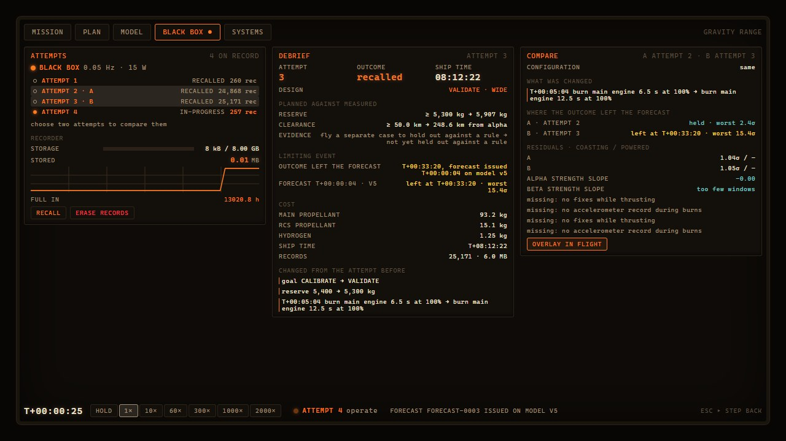
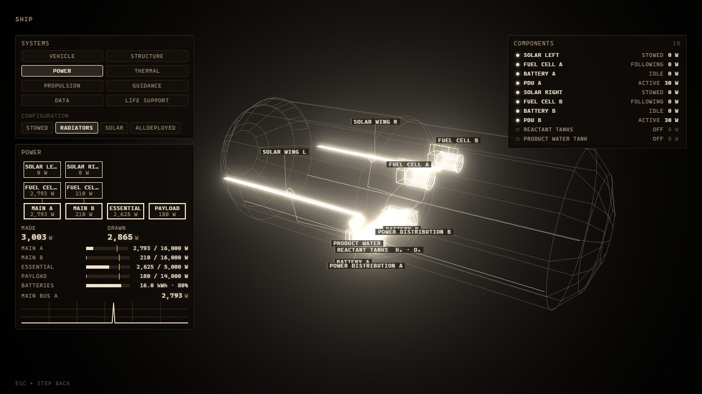

# Handoff: 2D — Control room and every screen

Thread: Claude (Fable) · Branch: `p2/2d-control-room` (worktree `.worktrees/2d`) · Date/time (Pacific): first handoff 2026-11-14 15:45 PST; update 2 (on 2G's 3D types; time per A12) 16:30 PST; update 3 (the model fault found; window sizes) 17:45 PST; update 4 (coverage sensed earlier; A8 decided) 18:25 PST; update 5 (S9's requests; S15's console fixes; 2G's screen data) 23:00 PST; **update 6 (SYSTEMS re-measured; seams for 3B's funnels and AU's sound) 2026-11-15**

**Interim.** The control room is the game's screen, on the live 3D simulation, ship, model and Black Box. The learning loop at Alpha and the slingshot's objective, ring and forecasts are on screen. S9's requests are in; S20's replay of S9 on the 3D build may bring more. Still to come: the owner's playtest.

## Update 6 (2026-11-15): SYSTEMS re-measured; seams for 3B's funnels and AU's sound

- **Merged main** at `1d000f9` (update 5 merged as `635245f`; 3C's Chain Link with its panel and lattice view). Clean.
- **SYSTEMS re-measured with S15's runner** on the computed columns: numbers under Claims.
- **3B (R13), three seams in my code:**
  - window views (`src/view3d/windowViews.ts`): a section registers how its phenomenon looks to the eye, and the window creates, feeds and retires one view per visible phenomenon, on a presentation shell between the bodies and the stars. The data comes from the window channel through `windowFields` in the adapter, which expects an optional `WindowView.fields` of `{ id, kind, visual }` (request 14);
  - `FieldViewFrame.clipSegment(a, b)` and `clipRevision`: the exact part of a segment inside FLIGHT's volume, as fractions of a→b, and a counter that changes with the projection;
  - `LineSet` forgets a material its user disposes, and has `release(material)`.

  The FLIGHT funnels need nothing more from me: 3B's field view registers itself. Its evidence panel can register with `registerEncounterPanel` for its encounter.
- **AU (R24):** the sound switch (`src/app/sound.ts`: `soundMuted`, `setSoundMuted`, `onSoundMuted`, kept in this browser): bottom right in the room and the holograms, in the console's footer, and the `M` key. AU has not launched; the one mount line goes in `ControlRoom`'s start-up effect when its module lands.
- **OP (R23):** OP has not launched, so there is no proposal yet. The room's existing levers for it: `RoomView.lose` (shake and fade), the light level and veil eased per view (`VIEW` in `layout.ts`), the window from `outside.ts`, and the title in `ControlRoom`. I'll take OP's proposal when it comes.
- **A20:** 2F's coasting budget is not on main yet; the loop will set it when `GameControls` exposes it.
- **S20, two more:** MISSION states the departure's conditions (speed from the centre of mass, the distance, the cap), and FLIGHT shows the nose's pitch beside its heading.

## Update 5 (2026-11-14 23:00 PST): S9's requests; S15's console fixes; 2G's screen data

- **Merged main** at `393b5a8` (2G's 3D flight end to end, studies S7–S21, A18). A fast-forward.
- **Prettier:** 23 of my files failed `prettier --check` (2G named three); formatted in a commit of their own (`0e762b5`).
- **S9, every request** (`docs/studies/s9/requests-2d.md`), checked in headless Chrome with real key events:
  - R1: the room shows `1 MAP · 2 SHIP · 3 CONSOLE · 4 FLIGHT` as buttons with the walk hint; ESC ▸ STEP BACK is a button in every view, the console's footer included.
  - R2: MISSION says "design recorded · no maneuver scheduled" (or the plan and its pending commands), that setup never plans a burn, that ENTER starts time and entering with no plan is allowed; OPEN PLAN.
  - R3: beside the warp steps, the next scheduled command, or else the issued forecast's next closest approach or end, in ship time and in wall time at the warp chosen, marked nominal (1× before ENTER; nothing past a forecast's end). 400 ship s reads 6:40 at 1× and 0.2 s at 2000×.
  - R3b: why warp last dropped to 1× (a new alert, or flying by hand) stays beside the time controls until the player raises warp.
  - R4: PLAN's rows live on the desk: kept across page and view changes; any edit makes the preview stale; the draft says empty / not previewed / previewed / committed as shown; CLEAR DRAFT; a new attempt sets the draft aside with a reason and offers it back unscheduled.
  - R5: each forecast in the debrief says "within envelope through T+…" and where it ends; a loss after the last forecast's end is "outside forecast coverage"; the closest measured clearance sits beside them.
  - R6: "BLACK BOX RETAINED · n ATTEMPTS" under the pip; the debrief shows the distances the attempt measured the pull at with their uncertainty, and OPEN MODEL; MODEL counts finished attempts, how many the model uses, and says why TEST is unavailable.
  - R7: "next test: fit on attempts … · check on attempt …", then a plain result (insufficient evidence / fails / passes · not adopted / adopted) before the statistics; each strength plot has its data as a table.
  - R8: an adopted rule says "forecasts from now use model vN" (and when the issued forecast is older), with OPEN PLAN; nothing is committed for the player.
  - R9: the console's screen is inert while down and the HUD during a loss; the scene canvas is a labelled focus target; focus follows the view (the page tab once the console is up, the scene in a hologram, the route the player left by, the room after a loss); ENTER hands focus to the warp steps.
  - R10: a focused control keeps Space, Enter, arrows, Home and End; other keys still reach the scene, so a click on a warp step never stops the flight keys; Escape in a field leaves the field first.
  - R11: `ModeChips` is a real radio group (one Tab stop, arrows choose; read-only modes are text); the warp steps use it; page tabs carry `aria-current`; one polite status region reads the console's last action.
  - R12: a new PLAN row takes focus, a removed one hands it on; remove and forget come after the fields; SYSTEMS keeps the ship's own order (no re-sort by live draw), with ADJUST and BACK TO EQUIPMENT.
  - R13: framing without a pointer in FLIGHT, MAP and SHIP (buttons, and keys `-` `=` zoom, `,` `.` turn, `[` `]` tilt, `/` reset); FLIGHT's "Look at" lists what the ship senses; MAP's plate lists what is charted, a lead included.
  - R14: the console page is a labelled region the keyboard can scroll; BLACK BOX: a row chooses the debrief, A and B are chosen in Compare, SET FLIGHT OVERLAY, and Recall/Erase sit last, in "Recorder and records".
  - R15, on the 3D game: caps hatched before ENTER and live inside; `W` and `R` by hand changed the sensed speed and vertical speed, lit their caps and drew the line of action; release issued a coasting forecast; the objective matches the briefing. One false reading fixed: before the first telemetry, batteries and buses said 0 (batteries in caution); they say "no reading" now.
- **S15, ranks 2–3** (`0b7f973`, numbers below): no drawing behind a settled console (its screen is opaque; the game and recorder run on); the canvas size from a ResizeObserver, not a layout read every frame; number formatters made once; the console reads Black Box's archive at most every 2 s while an attempt runs, and BLACK BOX works out its debrief and comparison once per read. Rank 6's patch held back, as asked.
- **2G's screen data:** the window drawn from `ViewSnapshot.window` (the sun where the game puts it; a body in shadow dark); `coverageEarlier` on FLIGHT's plane (a look near this moment of an earlier attempt counts, fading with encounter time); the MAP from `GameControls.chart()` through `chartView` in the adapter; PLAN shows `ForecastDraft.detail` (the envelope at its end by source, the present state's source, which rocks were forecast); MODEL has CHECK BURNS and FIND UNEXPLAINED PULL (`burns()`, `empirical()`), with their data; procedures saved and forgotten through Black Box; the debrief names a body on contact; MODEL shows `coverage[i].used` with its reason, and `fitFailure`. The UI lab reads the 3D fixtures (no `LIFT(2G)` marks left).
- **S8:** FLIGHT's "Margin to act": the nearest sensed object's clearance from the whole hull, the next forecast pass with the time to it (ship and wall), Δv above the reserve, and the miss from the frozen forecast over time.
- **S13:** a CREDITS tab on the console: LICENSE, NOTICE and THIRD-PARTY-NOTICES.txt under the deployment base, and the README's credits and verification.
- **A18 (1):** FLIGHT draws the stretch of the issued forecast the ship has already flown as past (quieter, still frozen) and the rest ahead; ready for 2F's commit without a hold.
- **R5 done:** the envelope's sections are the 2σ ellipse of the 3×3 covariance across the path.
- **S15's remaining SYSTEMS freeze:** the console's panels in computed columns instead of a multi-column flow (Columns.tsx); see Claims.
- **Merged main again** at e648fd6 (2F: commit timing, the exit rule, the encounter registry, power loss; 2C's forecast fields; S20). Clean.
- **2C's forecast fields (R21):** PLAN shows the present body, its age and the bodies' share of the envelope; a stale forecast says so on PLAN and in FLIGHT's forecast line.
- **S20's new items** (it audited main before this update, so its other priorities are the S9 work above): the worst miss carries its time and each comparison its interval (debrief and Compare); MISSION's recorder estimate now prices a rate as the ship does (15 W anywhere up to 1 Hz) and says a rate above one sample a second records no more; departure in its own frame, the believed centre of mass weighted by the model's GM, on MISSION and in FLIGHT (depart · c. of mass), with FLIGHT's speed labelled as past Alpha.
- **3C, ledger R4:** the mount point for encounter panels (src/console/encounterPanels.ts, a slot in FLIGHT, commands through GameControls.command), and FLIGHT's shortest range 120 m in the Chain Link (true metres; 5 km elsewhere). 3C's ChainLinkPanel is not on main yet; it registers itself (README of src/console/).
- **A20, my half:** a quiet coast at 60× or more draws 12 frames a second and refreshes the instruments twice a second; any input or a warp drop restores full rate at once. Dev build, 4× CPU throttle, 2000×, two rounds each: FLIGHT 69–76 → 107–130 ship s per wall s; the room 68–135 → 82–148 (noisy). Not yet through S15's production runner (port 4175 was 2G's), and 2F's per-frame budget is not exposed yet.

## Update 4 (2026-11-14 18:25 PST): coverage sensed earlier; A8 decided

- **Merged main** at `610b75d`: docs and studies only, no `src` changes. A fast-forward.
- **Coverage sensed earlier (R6), in the flight hologram's reference plane.** The plane now reads three ways, as visual-direction § 6.2 always specified:
  - tinted where the camera looks now;
  - plain where it looked earlier in this attempt;
  - hatched where it has not looked.

  The look fades over 2 h of ship time (`planeStyle.earlierMemory` [ASSUMED]), with the hatch returning, because rocks move. That makes keeping the camera on a region a visible choice (P12). The view remembers up to 24 sectors, each anchored where the ship was. A new attempt starts with none.
  - Code: `src/view3d/flight/coverageHistory.ts`, and the "earlier" state in `src/theme/three/holo-plane.ts`.
  - Checked in headless Chrome. With the camera aimed east, then north, then west, the region to the north read: hatched, then sensed now, then sensed earlier (no hatch, no edge), then faintly hatched an hour later, then fully hatched past 2 h. The region the camera never faced stayed hatched throughout.
- **A8 decided:** the owner kept all six defaults (`4291d31`); see Owner decisions.
- **Held for S9:** keyboard focus order. GPT's study S9 is auditing it, along with a cold player's first five minutes, and will send numbered requests.
- **Coming from 2G, not yet on main:**
  - the model-fault fix (`ab7801a`, request 2);
  - RCS axes on `fly` (request 1c);
  - `SAVE_FORMAT` 4;
  - a change to `src/view3d/adapter.ts`: the ship footprint covers all five hull prisms, with its test.

  The thrust marks and the believed velocity following a hand burn (requests 1a and 1b) are written there but not committed. I have not touched `adapter.ts` since update 2, so 2G's change should merge without conflict.

## Update 3 (2026-11-14 17:45 PST): the model fault found; window sizes

- **Merged main** at `0da357c` (`SAVE_FORMAT` 3; A8, A12, P10 and D11 recorded). A fast-forward with no conflicts.
- **The model fault is reproduced and its cause found** (request 2, rewritten). Every attempt has a stretch early on where the model's in-flight refresh fails. In the browser at 10× it ran from T+2:01 to T+3:32. The HUD shows "Model fault" for that stretch, and under A12 it drops warp to 1× ("warp to 1× · model fault"). So every player meets it shortly after ENTER.
  - A plan that frees the attitude 0.5 s after a 6.5 s burn keeps it failing for the rest of the attempt, and the model stays at v0.
  - The cause is in `src/model`: the arc fit inverts the undamped normal matrix while one of the arc's own parameters has no information and no prior.
  - Of the problems on my side of the screen, this one most needs fixing before the playtest.
- **Window sizes:** every console page and the flight view, after a dive, at 1024 × 640, 1280 × 720, 1366 × 768 and 1920 × 1080.
  - No page scrolls sideways, and nothing falls outside the window except inside a scrolling panel.
  - Level-bar labels and row names that were cut short ("CAMERA BEARING …", "POWER · ESSENTI…", "FUEL CELL HYDROGEN") now wrap to a second line (`src/theme/components/components.css`).
  - The debrief's outcome reads "flying" for an attempt in progress; "in-progress" was cut off at 1024 and 1366.
- **R5 held:** the model still forecasts a planar covariance (no out-of-plane terms) until 2G makes it 3D. True elliptical sections would flatten the tube into the ribbon today, so the tube stays at the longest axis until then.

## Update 2 (2026-11-14 16:30 PST): on 2G's 3D types; time per A12

- **Merged main** with 2G checkpoint 1 (the 3D type lift, `b8619e6`) and the favicon (`1b968c5`). The only conflict was 2F's bench, which stays deleted.
- **The switch to the 3D types:** hands-on flying goes through `GameControls.fly` on every axis, and the game issues the coasting forecast when the controls are released (`src/app/hands.ts`, `loop.ts`); the PLAN page's "body axis" burn is a 3D `direction` target (`src/view3d/adapter.ts`). Every other read already went through the adapter. The debrief lists each stretch of hands-on flying as one entry: how long the hands were on and which controls they held.
- **Time, per the owner's answer (A12):**
  - Each attempt waits at arrival while the player prepares, as long as they like. The encounter clock holds at T+0 and the flight controls do not answer. ENTER (on the console's footer, the MISSION page and the flight view) starts the encounter at 1×.
  - Inside the encounter there is no HOLD anywhere, only the warp steps 1× to 2000×.
  - A hidden page holds the game and lets it go when shown again.
  - A new caution or warning drops warp to 1× and says why on the console's footer.
  - My reading, for the owner to confirm: in the Gravity range "the prepare phase before entering" is the arrival state with the encounter clock held, because the range has no transit to simulate.
- **Found:** Black Box records saved by the planar build make the 3D model fail (request 9). Main already deploys the 3D game to Pages, so anyone with a planar save there meets it.

## Delivered

**The room in the app** (`src/view3d/room/`, `src/app/`)
- `src/app/ControlRoom.tsx`, `loop.ts`, `hands.ts`, `control-room.css`: the one screen. The frame loop advances the game, takes `snapshot()`, flies from the keys and hands the room what to draw. 2F's bench is removed.
- `src/view3d/room/RoomView.ts`, `shell.ts`, `dress.ts`, `textures.ts`, `layout.ts`: the walkable room, the white-dot cursor, the four pads, view changes, the dressing, the loss sequence back to the door. Ported from `prototypes/room/`.
- `src/view3d/room/outside.ts`: the window. Bodies and rocks at their true angular size, turning as the ship turns.
- Time (A12): each attempt waits at arrival until the player enters; inside the encounter there is no pause, only warp from 1×; a hidden page holds the game; a new caution or warning drops warp to 1×. ENTER and the warp steps are on the console's footer and the flight view.

**FLIGHT, in 3D** (`src/view3d/flight/FlightHolo.ts`, `src/console/FlightHud.tsx`)
- Bodies and rocks where the ship believes they are. Tracked rocks are bright; rocks only seen are dim with a 2σ ring; never-seen rocks are absent.
- The issued forecast dotted and frozen, the measured trail solid, the envelope as a 2σ tube with a ribbon in the reference plane (hatched where extrapolating, distinct inside a validated span), ending at a horizon ring. A link from the ship to where the forecast put it now, with the miss in metres and σ.
- Forecast tracks of other objects and closest-approach marks from `objects` and `closestApproaches`; alerts against the clearance the player planned.
- The ship as a large symbol set back, true position at the centre of mass, true hull at true scale, thrust at its points of application, velocity, turn-rate arcs, a level reference plane with stalks, sensor coverage as cones and a plane that reads sensed now, sensed earlier in this attempt (fading) and never sensed (hatched), objective gates, the two-attempt overlay.
- Flying by hand through `GameControls.fly`: `W` main engine (`Shift` quarter throttle), `S` retro, `A` / `D` lateral, `R` / `F` vertical, `Q` / `E` yaw, `↑` / `↓` pitch, `X` cut. The game issues a coasting forecast when the hands come off. Committed timed burns stay available from the PLAN page.
- Field plugins: `src/view3d/fieldViews.ts`, loaded from `src/view3d/fields/<kind>/`, documented in `src/view3d/README.md`.

**CONSOLE** (`src/console/`)
- MISSION (mission design, 5C-0 request 2), PLAN (timed burns, pointing, preview, commit, procedures, Recall), MODEL (parameters, strength against distance, rule test / adopt / revoke, validated spans against the flight, calibration freshness, confounding, coverage), BLACK BOX (attempts, debrief, compare, overlay, recorder), SYSTEMS (buses, stores, heat, equipment modes and allocation).
- `mission.ts`: the design is recorded in Black Box as a `mark` command; the debrief (5C-0 request 3) is computed from the attempt's record: planned against measured, the limiting event, cost, what changed from the attempt before, where each forecast was left.
- Margins on show: propellant against the planned reserve, power, heat and recorder in the flight view and on SYSTEMS.

**SHIP and MAP** (`src/view3d/ship/`, `src/view3d/map/`, `src/console/ShipPanels.tsx`, `MapPlate.tsx`, `chart.ts`)
- SHIP: 1E's drawing, one part per assembly of the real `ShipDefinition`, systems isolate; beside it a schematic, levels, trends, readouts, components and the selected assembly's modes and allocation, from the believed ship.
- MAP: only what is charted: one region with what Black Box holds of it; ENTER REGION shows the environment chart-up.

**One adapter for the 3D lift** (`src/view3d/adapter.ts`): every planar-specific read goes through it and it accepts both contract shapes.

**Theme** (`src/theme/`): `room.ts`, `dressing.ts`, `hud.ts`, `three/holo.ts`, `three/holo-plane.ts`, `three/ship-holo.ts`, `three/map-holo.ts`; `motion.maxDisplayTurn`, `motion.coastForecastDelay`; overlay tokens in `css.ts`. The UI lab still loads.

**Docs:** `src/view3d/README.md`, `src/console/README.md`, `src/app/README.md`, `src/theme/README.md`, `docs/design/visual-direction.md` (pointer and screenshots), `docs/design/img/room-*.jpg`.

## How to verify

```bash
npm run check
```

```bash
npm run build
```

```bash
npm run dev
```

- `npm run check`: typecheck, lint and 489 tests in 49 files pass on the merged branch (update 4). `npm run build` passes (one chunk, about 1.3 MB, most of it Three.js).
- In the browser: steps in `src/app/README.md` § Playing the Gravity range.
- Scripted run in headless Chrome (dev build, the model in its worker, Black Box in IndexedDB), driven through `window.__recursion`: walk in; record a design; fly by hand; a shallow dive on a committed plan at 2000×; Recall; a deeper dive; Recall; test the distance law held out; adopt; compare; a third dive with the rule; a Newtonian plan into Alpha and the loss. No page errors and no model fault. The screenshots below are from that run.
- The production build (`npm run build`, served with `vite preview`) in headless Chrome, before update 2: the four views open from real key events, the clock runs, the development handle is absent, and the only console entry was a 404 for `favicon.ico` (since fixed on main).
- Update 2, in the Browser pane on the merged dev build: before entering, the clock held at T+0, `W` sent nothing and the key caps were off; ENTER started the encounter at 1×; no HOLD control was on the page; `W` went out as `fly` and its release brought a coasting forecast from the game; hiding the page held the clock and showing it resumed; breaking the planned reserve at 2000× dropped warp to 1× with "warp to 1× · reserve broken" on the footer. With fresh records, no model fault.
- Update 2, the learning loop on the merged build in headless Chrome (empty Black Box, model in its worker), driven through the console's own calls: each attempt waited at arrival until entered; a 6.5 s and a 12.5 s retrograde dive on committed plans at 2000×, with Recall between; the model then measured Alpha's pull at ×1.37 at 497 km against ×0.99 at 1,000 km; the distance law fitted on the first dive and held out on the second passed (T/ν 1.07 against 1.14, exponent 2.499) and was adopted (χ²/ν 1.06, validated 500–1,003 km); with it, a 16 s dive's forecast reached the closest approach to Alpha (185 ± 11 km). During the deep dive, before the rule, the outcome left the forecast and the warp dropped to 1× twice with "off the forecast" (A12). No model fault and no page errors.
- Update 3, in headless Chrome on the merged dev build, after a 5.7 h dive:
  - Every console page and the flight view at 1024 × 640, 1280 × 720, 1366 × 768 and 1920 × 1080.
  - At each size the page did not scroll and no text was cut off or outside the window, except inside panels that scroll.
  - Before the theme fix, six labels and one readout were cut off.
  - The model fault traced in request 2 was reproduced in the browser and in the test runner.
- Update 5, in headless Chrome on the merged dev build (scratch scripts driving real key events and `window.__recursion`): S9's R1–R4 (routes, the design's status, the next event's wall time, the draft across FLIGHT, MODEL and back), R5–R8 after two recalled attempts, the keyboard set (Tab order in the room, CONSOLE and BLACK BOX; arrows on chip groups; Space on CHART UP; Escape in a field; focus after views, loss, Recall and ENTER; SYSTEMS ADJUST and back), R13's framing keys and lists, R15 by hand on the 3D game, the window channel, the UI lab. S15's runner on the production build, before and after (Claims).
- Not done: the owner's playtest. Pointer-lock mouse look was not exercised (an automated browser cannot lock the pointer; drag-to-look and the keys were). No one has played it by hand end to end.






More in `docs/design/img/room-*.jpg`: the mission page, the plan page, the systems page, hands-on flight, the coasting forecast, the compare overlay, the region view, the loss screen.

## Reconciliation (Step 1)

Each item is a contradiction or gap between the composition, the prototype, the decisions and the code, with a proposed fix and an owner.

| # | Against | Finding | Proposed fix | Owner |
|---|---|---|---|---|
| R1 | A6 | The build's objective is still the low orbit about Alpha (`ORBIT 450–550 KM`, `RESERVE 5600 KG`), not the slingshot past Beta through a belt. Four rocks orbit Beta. | Done by 2G (merged in update 5): `depart` past Beta, and Beta's ring. The room draws the briefing as it is; MISSION shows `DEPART 50 M/S`. | done |
| R2 | A6, P11 | Pointing the camera at a rock gives bearing fixes only. The rock never becomes tracked, the model cannot use the fixes, and no forecast carries its track or a closest approach to it ("Rock probe" under Claims). The flight view is ready to draw both. | Done by 2G: every briefed rock is a known-size target, ranged and tracked by the navigator and the model. | done |
| R3 | A3, P11 | The snapshot has no window channel. The window is drawn from the believed world, so a rock the ship has not catalogued cannot be seen by eye either, the sun's direction is a display value (`render.keyLight`) and there are no shadows. | Done: 2G's `ViewSnapshot.window`, drawn by `outside.ts` since update 5. | done |
| R4 | A8, A11 | Hands-on flying on three axes needed `GameControls.fly`. | Done in update 2: `hands.ts` flies through `fly`. What `fly` does in the game on checkpoint 1 is request 1. | done |
| R5 | P10 | The envelope is drawn as a tube of the covariance's longest 1σ axis, not its ellipsoid. It never understates, but across the path it can look wider than the forecast's miss uncertainty when the longest axis lies along the path [ASSUMED, not measured]. The closest-approach marks use the forecast's own σ. | Unblocked in update 5: the model now forecasts a full 3×3 covariance. Draw elliptical sections across the path (`projectCov3`, `covEllipse`). Not yet done; next on this branch. | 2D |
| R6 | P11 | Coverage had no history: the plane was hatched wherever the camera was not looking now. "Sensed earlier" was not distinguished (1E's question). | Done: this attempt in update 4; earlier attempts in update 5 from 2G's `coverageEarlier` (a look counts as fresh as it is near in encounter time). | done |
| R7 | P12 | Recording is not felt as a resource in this encounter: at 0.05 Hz the store fills in over a year of ship time, and the recorder draws 15–100 W against 2.6 kW. | A capacity or sample size that makes a high rate during a pass a real choice. | 2F, owner |
| R8 | A9 | `recall()` begins the next attempt at once, so there is no ended state in which to show the debrief before the walk back. A reload closes the attempt in progress as recalled. | None needed for the room: the debrief waits on the console and the BLACK BOX tab is marked. Noted for the P15 review of Recall. | owner |
| R9 | P11 | A lost ship's `contact` event has no `with` when the camera was not looking, even for a briefed body. The debrief then says "an object the ship could not identify" for Alpha. | Done by 2G; the debrief shows the body's name. | done |
| R10 | P6 | Committing a plan replaces what was still scheduled, so a coasting forecast issued as a commit would cancel a pending trim. | Done by 2G: the game's coasting forecast schedules nothing and leaves a scheduled plan alone. | done |
| R11 | P14 item 1 | The room has four seats; the crew is one. | Owner decision 1 below. | owner |

No contradiction found with P6 (no control plans a burn), A5 (validated spans shown against the flight), A9's loss sequence or A10.

## Owner decisions

Taken (already in A8): time runs in the room; 8 m; hands-on; 3D map of only what is charted; ship set back.

Taken in update 2 (**A12**, owner): no pause inside an encounter, because planning ahead is rewarded; between encounters (in the Gravity range, the prepare phase before entering) the player adjusts as long as they like; inside, every adjustment is available in real time only; warp for long coasts, never slower than 1×; a hidden page holds the game; a new alert drops warp to 1×. Built as described under Update 2.

Taken in update 4 (**A8**, owner, `4291d31`): the six defaults stay, as built. None is open.

| # | Decision | As built |
|---|---|---|
| 1 | Other crew seats | Four empty seats (P14: a crew of one) |
| 2 | Heading-up or chart-up | Heading-up, turning no faster than 0.35 rad/s; `U` or the button switches to chart-up |
| 3 | Roll | Held; yaw and pitch by hand |
| 4 | Window arc | 150° |
| 5 | Loss sequence length | About 6 s; a Recall skips the shake |
| 6 | Room palette | Night Watch, warm |

## Claims, labelled

**S15's console cases, before and after update 5** [DEMONSTRATED: `tools/studies/s15/measure.mjs --phase frames --views room,systems,blackbox,mission,flight --profiles modest --warps 1,2000 --repeats 2 --seconds 8`, production builds of `48326c0` (before) and `0b7f973` (after) from scratch checkouts, run one after the other with nothing else running; pooled nearest-rank quantiles, ms; the raw runs were not committed (they are outside 2D's paths)]

| View, modest profile | 1× p95 | 1× worst | 2000× p95 | 2000× ship s / wall s |
|---|---|---|---|---|
| BLACK BOX | 36.4 → 6.3 | 90.9 → 60.6 | 109.1 → 90.8 | 148.9 → 238.5 |
| MISSION | 48.3 → 6.4 | 91.0 → 36.3 | 96.9 → 60.6 | 157.4 → 299.3 |
| SYSTEMS | 78.6 → 12.2 | 285.0 → 345.5 | 284.8 → 303.1 | 95.2 → 98.7 |
| room (unchanged code) | 66.6 → 54.6 | 84.8 → 97.0 | 145.4 → 127.1 | 114.4 → 104.7 |
| FLIGHT (unchanged code) | 66.7 → 78.8 | 103.1 → 127.3 | 121.2 → 109.1 | 131.5 → 148.0 |

- No model errors in either run (2G's fix holds under S15's stress).
- SYSTEMS still froze, so I profiled it (`--phase profile --profile-case modest:systems:2000`): at 2000× the JavaScript is the simulation (power dispatch, target visibility, thermal: S15 rank 1, 2G's), and layout was 1.75 s of the 8 s trace, 60 layouts of up to 90 ms. The console's multi-column flow re-balanced every column at each refresh. Measured in the dev build at 4× CPU throttle (Chrome's `LayoutDuration`): 83–92 ms of layout per second on SYSTEMS with the multi-column flow, 2.7 ms with update 5's computed columns (`Columns.tsx`), 2.2 ms on BLACK BOX. That change came after the S15 runs above; its effect on SYSTEMS's frame times has not been through S15's runner yet.
- Room and FLIGHT did not change between the two builds; their differences are run-to-run spread.
- **Update 6, SYSTEMS on the computed columns** (S15's runner, modest profile, production build of `fa6b092`, nothing else running, 2 × 8 s per case): 1× p95 **12.1 ms**, worst **42.5 ms** (from 78.6 and 285–346 before); 2000× p95 **90.9 ms**, worst **121.3 ms**, **139.6** ship s per wall s (from 285–303, 400–412 and 95–99). An earlier run the same day, during which a typecheck overlapped, gave 72.8 / 115.1 ms and 194 ship s per wall s at 2000×: the spread between runs at top warp is wide. The freeze is gone; what remains at 2000× is mostly the simulation.

**Shown by running it** [DEMONSTRATED: scripted run in headless Chrome on the dev build, 2026-11-14; numbers vary a little with real-time model timing]
- Hands-on, on the planar build (a held `burn` command): holding `W` 2.5 s raised the speed from 99.93 to about 102.3 m/s; releasing issued a frozen forecast on the model's current version.
- A shallow dive (6.5 s retrograde) on a committed plan: the trail left the forecast by about 19 km (0.6σ) after 5.3 h; the forecast ended at its horizon.
- After a second, deeper dive (12.5 s) the model measured Alpha's pull at about ×1.38 at 549 km against ×0.99 at 1,000 km against its own law (one run), and the strength plot showed the slope.
- The distance law, fitted on the shallow dive and held out on the deep one, passed (T/ν 1.01–1.13 against 1.12–1.14 in two runs; exponent 2.499–2.500), earned a validated span of about 500–1,003 km around Alpha, and was adopted from the page. Fit χ²/ν fell to 1.0–1.1 and the strength plot went flat at ×1.
- With the rule, the forecast for a 16 s dive reached its closest approach (clearance 174.5 ± 10.3 km).
- A plan sized for the old law (41 s retrograde) hit Alpha; the room shook, cut to black with Black Box's pip and the next attempt's number, and the player was back at the door with the debrief on the console.
- Black Box survived a reload: the attempts were restored from IndexedDB and the debrief of a restored attempt was computed from its record.
- On 2G's checkpoint 1 (before update 2, on a trial merge; the same code is now merged): the room ran with no errors on the quaternion attitude, hull prisms and sensor cones; each release of the controls made the game issue a coasting forecast. Holding `W` for 2.5 s used 22 kg of main propellant, but the believed velocity did not change during or after the burn, the snapshot carried no thrust marks while a control was held, and the RCS keys used no propellant (requests 1a–1c).
- Rock probe: with the camera pointed at rock `a-02` for 30 min of ship time, Black Box recorded 54 bearing fixes on it and no range fix. The rock stayed untracked in the believed world (`tracked: false`, `lastSeen: 0`) and the next forecast carried tracks for Alpha and Beta only. Pointing at a rock therefore does not yet probe the law (R2).
- Frame rate at 1280 × 720 on integrated Intel UHD graphics (headless Chrome, two runs): 75–77 frames a second in FLIGHT, 74–77 with 411 rocks in the believed world, 59–71 walking the room. [Says nothing about a weaker laptop or a larger window.]
- An 8 h dive takes 12–19 s at 2000× (the frame budget limits it; the HUD says so).

**Shown by tests** [DEMONSTRATED]
- `src/view3d/adapter.test.ts`: a planar value and its three-dimensional form read to the same scene result (positions, covariance, attitude, cones, hull).
- `src/console/console.test.ts`: the design round trip through a record; the debrief on the fixture attempts; overlay stylesheets hold no literal colour, pixel size or timing and use only tokens `applyTheme()` defines.
- `src/app/hands.test.ts`: the keys map to the body axes and go out through `fly`; releasing sends a neutral input once; the hands never start or pause the encounter.
- `src/console/time.test.tsx`: before the encounter only ENTER is offered; inside it there is no HOLD and no step under 1×; entering works only from the prepare phase; which alerts count as new (a caution or warning that appears, worsens or comes back; never an advisory).
- `src/console/console.test.ts`: a held burn is listed by the time it ran; a stretch of hands-on flying is one entry.
- `src/view3d/flight/coverageHistory.test.ts`, `src/theme/three/three.test.ts`:
  - A sector is remembered where the ship was and renewed while the sensor stays on it.
  - A new one is kept when the sensor turns or the ship moves.
  - It fades over the memory and is forgotten after it, or on a new attempt; the stalest goes first when full.
  - The plane takes the earlier sectors, freshest first, up to its limit.
- `src/view3d/flight/flight.test.ts`: the hologram draws the fixtures; alerts come only from the issued forecast; an undetected field never reaches a plugin.
- `src/view3d/ship/ship.test.ts`, `src/view3d/map/map.test.ts`: the ported drawing matches the prototype's part and segment counts; the map's layout and picking.

**Play values** [ASSUMED], all in `src/theme/` or named constants
- Hologram range 1,500 km by default, 5 km to 12,000 km; ship set back half the volume's radius; smallest drawn rock 12 mm.
- The display turns with the ship at no more than 0.35 rad/s.
- Coverage sensed earlier fades over 2 h of ship time. The view keeps up to 24 sectors, and keeps a new one when the sensor turns by half its width or the ship moves a fiftieth of the sensor's reach.
- Hands-on: the clock drops to 1× when the hands go on. (Turn rates and thrust levels for `fly` are 2G's.)
- A12: an alert counts as new when a caution or warning appears, worsens, or comes back after clearing; advisories never drop the warp, so a forecast horizon passing does not stop a long coast. [ASSUMED: the owner said "a new alert".]
- Mission defaults: reserve 90% of the main tank, clearance 50 km, recorder 0.05 Hz, goal CALIBRATE, approach WIDE.
- Alerts: caution when the predicted clearance less 2σ is inside the planned clearance; warning when it reaches the surface or a third of the planned clearance; a body's approach is shown only within 12 radii; "off the forecast" beyond 3σ.
- Procedure match tolerances 20 km, 2 m/s, 0.1 rad. Commands within 120 s of each other in two attempts count as given at the same time.
- Outside the window, distances are compressed monotonically (30 m to 5 km of scene) and sizes scaled to keep true angular size.

**The prototype: ported, replaced, left**
- Ported nearly as it stood: the room shell and dressing (verified part for part against the prototype), console, pads, cursor, camera poses, veil and dimming, loss sequence; the flight hologram's look; the ship drawing (56 parts, 9,638 segments, no differences); the map's look.
- Replaced by the real thing: `world.js` by the game; the toy forecast, sensor model and alerts by the model's forecast, the snapshot's coverage and its closest approaches; every console page; the ship screens' drawn panels by theme primitives on the believed ship; the map's content by a chart from Black Box.
- Left as placeholder, marked on screen or here: life support's stores and cabin air (the ship does not report them); trend graphs hold this session's readings, not Black Box history; the map has no leads, corridors or reach until the expedition supplies them; the console's top as seen from the room is painted dressing.
- Not ported: the lattice scan chips (a field plugin's job in Phase 3), the glimmer in the window, the window-arc slider (the arc is a constant; `setWindowArc` exists).

**Local primitives for the UI lane to adopt** (`src/console/controls.tsx`, `StrengthPlot.tsx`, `console.css`): action button, labelled number and choice fields, label-and-value line, caption, time controls, strength-against-distance plot, flight key caps, hologram tags.

## Open questions and uncertainty

- **Speed on a modest laptop** (S15): the 3D game runs slower than S15's planar baseline at top warp (achieved 95–157 ship s per wall s on the modest proxy before update 5's fixes, against 270–490 in S15's baseline); most of that is the simulation (S15 rank 1, 2G's). Update 5's numbers are under Claims.
- **The slingshot has not been flown through the screens by a person.** 2G flew it by hand in a test; the room draws its objective, ring and forecast, but nobody has played the whole Gravity range in the room.
- **A12 in the Gravity range:** I read "the prepare phase before entering" as the arrival state with the encounter clock held. If the owner wants time to run there too, the range needs a transit leg to run it on.
- **Only runs by a script, none by a person.** Window sizes are checked down to 1024 × 640 (update 3). Keyboard paths were driven with real key events in headless Chrome (update 5), not by a person with a screen reader; pointer-lock look is unchecked.

## Requests outside my ownership

1. *(Done by 2G, merged in update 5: hands-on thrust drawn and believed, RCS axes on `fly`. Checked on the 3D game, R15 above.)*
2. *(Done by 2G, `ab7801a`, merged in update 5: one unusable attempt no longer stops the model. Browser check in update 5 under Claims.)*
3. *(Done by 2G: `depart` and Beta's ring; rocks as known-size targets.)*
4. *(Done by 2G: the window channel, the chart, a name on contact. All on screen since update 5.)*
5. *(Done by 2G: `ForecastDraft.detail` through `preview` and `commit`, `RuleControls.burns()` and `.empirical()`, `saveProcedure` / `removeProcedure`. All on screen since update 5.)*
6. **2F, balance:** recording as a real trade (R7).
7. *(Done on main, `0da357c`: A8's defaults, the P10 tube and turn rate, A12's reading for the Gravity range, and D11.)*
8. *(Done on main, `1b968c5`: a favicon.)*
9. *(Done on main, `0da357c`: `SAVE_FORMAT` 3, so planar Black Box saves no longer load into the 3D game.)*
10. **2G, `src/game/belief/blackbox.ts`: reading the record in progress copies all of it.** `archive()` and `attempt(id)` for the live attempt rebuild it with `recorder.snapshot()` after every change, and while flying it changes every tick, so every read is a copy of the whole record. The console now reads at most every 2 s (update 5, S15), but the loop's `chart()` still calls `archive()` every second. A live view that does not copy (counts and the latest items, or a version number to compare) would let both read freely.
11. **2F, A18 (1): `commit` without the hold.** Nothing more is needed from the screens: FLIGHT draws the stretch of a forecast already flown as past, and PLAN's status line says only that the forecast is on its way, hold or no hold.
12. **2F, A20: the simulation's per-frame budget while coasting.** Proposed with my cadence: 14 ms a frame while coasting (just under a 60 Hz frame; the drawn frames are 12 a second), 10 ms otherwise; full budget only while `coastCadence` holds (warp ≥ 60×, no input for 1.5 s, hands off). I'll set it from the loop when `GameControls` exposes it, then measure with S15's runner.
13. **3C, R4:** register `ChainLinkPanel` from `src/console/encounters/chain-link/index.ts` (`src/console/README.md` § Encounter panels). The panel's state (per-channel `reportedAt`, `validUntil`, delivered watts) has to come from the game's telemetry, which is 2F's to expose; the mount point passes the frame's snapshot and `GameControls`.
14. **Integrator / 2F, A19 window channel (3B's R13):** an optional `WindowView.fields: readonly { id: string; kind: string; visual: JsonValue }[]`, one per phenomenon the eye can see, in its section's light-only schema (3B's `well-optical-v1`: directions and brightness, never a range). The window reads it through `windowFields` in `src/view3d/adapter.ts` today, so promoting it to the contract changes nothing on screen.
15. **3B:** register the optical funnel view with `registerWindowView('well', ({ group, displayRadius }) => makeOpticalFunnelView(group, displayRadius))` from `fields/wells/index.ts` (dynamic import, as the lattice does); use `frame.clipSegment` and `frame.clipRevision` for the funnel's lines; register the evidence panel with `registerEncounterPanel`.
16. **AU:** `startAudio` (or whatever the module exports) should take the sound switch (`soundMuted`, `onSoundMuted` from `src/app/sound.ts`) and the game; say its signature and I'll add the mount line.
17. **2F, the believed objective (S20):** the game's `depart` rule has `learningFree` (burns while the ship cannot leave Alpha's lobe are free) and `assist` (a real swing past Beta), but `Objective` in the contracts carries only `depart` and `maxDeltaV`. MISSION therefore says `at most 16 m/s spent on leaving`. Carrying both on the believed objective (and the running Δv that counts) would let the screens state the rule exactly.

## Notes for the next phase

- 3F continues from here. New console pages go in `src/console/pages/` and into `PAGES` in `ConsoleScreen.tsx`; encounter panels go in `src/console/encounters/`; field views in `src/view3d/fields/<kind>/`.
- `window.__recursion` (dev build only) and `?view=` make scripted runs and screenshots possible; `step()` runs frames when the page is in the background. `prototypes/shots/capture.mjs` plays the whole loop in headless Chrome and saves the screenshots used here (it enters the range before flying, per A12). A hidden page's timers are throttled hard by the browser, so long scripted runs belong in headless Chrome, not a hidden pane.
- The 5 Hz instrument refresh and the per-frame scene are separate: a slow panel never slows the scene.
