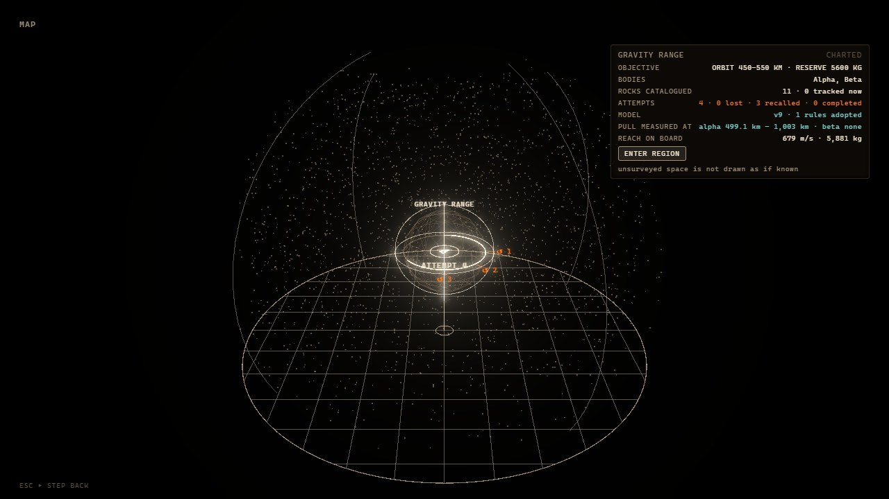
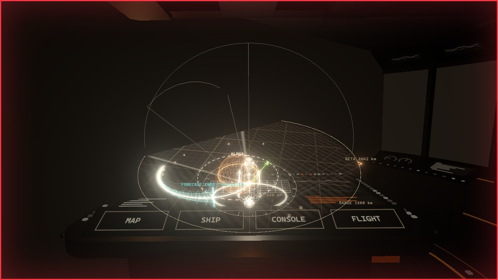

# Handoff: 2D — Control room and every screen

Thread: Claude (Fable) · Branch: `p2/2d-control-room` (worktree `.worktrees/2d`) · Date/time (Pacific): first handoff 2026-11-14 15:45 PST; update 2 (on 2G's 3D types; time per A12) 16:30 PST; **update 3 (the model fault found; window sizes) 17:45 PST**

**Interim.** The control room is the game's screen, on the live simulation, ship, model and Black Box. The learning loop at Alpha plays in it end to end. Still to come on this branch: the slingshot objective and belt when 2G's step 5 lands, the owner's answers to the open questions below, and the owner's playtest.

## Update 3 (2026-11-14 17:45 PST): the model fault found; window sizes

- **Merged main** at `0da357c` (`SAVE_FORMAT` 3; A8, A12, P10 and D11 recorded). A fast-forward with no conflicts.
- **The model fault is reproduced and its cause found** (request 2, rewritten). Every attempt has a stretch early on where the model's in-flight refresh fails. In the browser at 10× it ran from T+2:01 to T+3:32. The HUD shows "Model fault" for that stretch, and under A12 it drops warp to 1× ("warp to 1× · model fault"). So every player meets it shortly after ENTER.
  - A plan that frees the attitude 0.5 s after a 6.5 s burn keeps it failing for the rest of the attempt, and the model stays at v0.
  - The cause is in `src/model`: the arc fit inverts the undamped normal matrix while one of the arc's own parameters has no information and no prior.
  - Of the problems on my side of the screen, this one most needs fixing before the playtest.
- **Window sizes:** every console page and the flight view, after a dive, at 1024 × 640, 1280 × 720, 1366 × 768 and 1920 × 1080.
  - No page scrolls sideways, and nothing falls outside the window except inside a scrolling panel.
  - Level-bar labels and row names that were cut short ("CAMERA BEARING …", "POWER · ESSENTI…", "FUEL CELL HYDROGEN") now wrap to a second line (`src/theme/components/components.css`).
  - The debrief's outcome reads "flying" for an attempt in progress; "in-progress" was cut off at 1024 and 1366.
- **R5 held:** the model still forecasts a planar covariance (no out-of-plane terms) until 2G makes it 3D. True elliptical sections would flatten the tube into the ribbon today, so the tube stays at the longest axis until then.

## Update 2 (2026-11-14 16:30 PST): on 2G's 3D types; time per A12

- **Merged main** with 2G checkpoint 1 (the 3D type lift, `b8619e6`) and the favicon (`1b968c5`). The only conflict was 2F's bench, which stays deleted.
- **The switch to the 3D types:** hands-on flying goes through `GameControls.fly` on every axis, and the game issues the coasting forecast when the controls are released (`src/app/hands.ts`, `loop.ts`); the PLAN page's "body axis" burn is a 3D `direction` target (`src/view3d/adapter.ts`). Every other read already went through the adapter. The debrief lists each stretch of hands-on flying as one entry: how long the hands were on and which controls they held.
- **Time, per the owner's answer (A12):**
  - Each attempt waits at arrival while the player prepares, as long as they like. The encounter clock holds at T+0 and the flight controls do not answer. ENTER (on the console's footer, the MISSION page and the flight view) starts the encounter at 1×.
  - Inside the encounter there is no HOLD anywhere, only the warp steps 1× to 2000×.
  - A hidden page holds the game and lets it go when shown again.
  - A new caution or warning drops warp to 1× and says why on the console's footer.
  - My reading, for the owner to confirm: in the Gravity range "the prepare phase before entering" is the arrival state with the encounter clock held, because the range has no transit to simulate.
- **Found:** Black Box records saved by the planar build make the 3D model fail (request 9). Main already deploys the 3D game to Pages, so anyone with a planar save there meets it.

## Delivered

**The room in the app** (`src/view3d/room/`, `src/app/`)
- `src/app/ControlRoom.tsx`, `loop.ts`, `hands.ts`, `control-room.css`: the one screen. The frame loop advances the game, takes `snapshot()`, flies from the keys and hands the room what to draw. 2F's bench is removed.
- `src/view3d/room/RoomView.ts`, `shell.ts`, `dress.ts`, `textures.ts`, `layout.ts`: the walkable room, the white-dot cursor, the four pads, view changes, the dressing, the loss sequence back to the door. Ported from `prototypes/room/`.
- `src/view3d/room/outside.ts`: the window. Bodies and rocks at their true angular size, turning as the ship turns.
- Time (A12): each attempt waits at arrival until the player enters; inside the encounter there is no pause, only warp from 1×; a hidden page holds the game; a new caution or warning drops warp to 1×. ENTER and the warp steps are on the console's footer and the flight view.

**FLIGHT, in 3D** (`src/view3d/flight/FlightHolo.ts`, `src/console/FlightHud.tsx`)
- Bodies and rocks where the ship believes they are. Tracked rocks are bright; rocks only seen are dim with a 2σ ring; never-seen rocks are absent.
- The issued forecast dotted and frozen, the measured trail solid, the envelope as a 2σ tube with a ribbon in the reference plane (hatched where extrapolating, distinct inside a validated span), ending at a horizon ring. A link from the ship to where the forecast put it now, with the miss in metres and σ.
- Forecast tracks of other objects and closest-approach marks from `objects` and `closestApproaches`; alerts against the clearance the player planned.
- The ship as a large symbol set back, true position at the centre of mass, true hull at true scale, thrust at its points of application, velocity, turn-rate arcs, a level reference plane with stalks, sensor coverage as cones and a hatched plane where nothing is sensed, objective gates, the two-attempt overlay.
- Flying by hand through `GameControls.fly`: `W` main engine (`Shift` quarter throttle), `S` retro, `A` / `D` lateral, `R` / `F` vertical, `Q` / `E` yaw, `↑` / `↓` pitch, `X` cut. The game issues a coasting forecast when the hands come off. Committed timed burns stay available from the PLAN page.
- Field plugins: `src/view3d/fieldViews.ts`, loaded from `src/view3d/fields/<kind>/`, documented in `src/view3d/README.md`.

**CONSOLE** (`src/console/`)
- MISSION (mission design, 5C-0 request 2), PLAN (timed burns, pointing, preview, commit, procedures, Recall), MODEL (parameters, strength against distance, rule test / adopt / revoke, validated spans against the flight, calibration freshness, confounding, coverage), BLACK BOX (attempts, debrief, compare, overlay, recorder), SYSTEMS (buses, stores, heat, equipment modes and allocation).
- `mission.ts`: the design is recorded in Black Box as a `mark` command; the debrief (5C-0 request 3) is computed from the attempt's record: planned against measured, the limiting event, cost, what changed from the attempt before, where each forecast was left.
- Margins on show: propellant against the planned reserve, power, heat and recorder in the flight view and on SYSTEMS.

**SHIP and MAP** (`src/view3d/ship/`, `src/view3d/map/`, `src/console/ShipPanels.tsx`, `MapPlate.tsx`, `chart.ts`)
- SHIP: 1E's drawing, one part per assembly of the real `ShipDefinition`, systems isolate; beside it a schematic, levels, trends, readouts, components and the selected assembly's modes and allocation, from the believed ship.
- MAP: only what is charted: one region with what Black Box holds of it; ENTER REGION shows the environment chart-up.

**One adapter for the 3D lift** (`src/view3d/adapter.ts`): every planar-specific read goes through it and it accepts both contract shapes.

**Theme** (`src/theme/`): `room.ts`, `dressing.ts`, `hud.ts`, `three/holo.ts`, `three/holo-plane.ts`, `three/ship-holo.ts`, `three/map-holo.ts`; `motion.maxDisplayTurn`, `motion.coastForecastDelay`; overlay tokens in `css.ts`. The UI lab still loads.

**Docs:** `src/view3d/README.md`, `src/console/README.md`, `src/app/README.md`, `src/theme/README.md`, `docs/design/visual-direction.md` (pointer and screenshots), `docs/design/img/room-*.jpg`.

## How to verify

```bash
npm run check
```

```bash
npm run build
```

```bash
npm run dev
```

- `npm run check`: typecheck, lint and 481 tests in 48 files pass on the merged branch (update 2). `npm run build` passes (one chunk, about 1.3 MB, most of it Three.js).
- In the browser: steps in `src/app/README.md` § Playing the Gravity range.
- Scripted run in headless Chrome (dev build, the model in its worker, Black Box in IndexedDB), driven through `window.__recursion`: walk in; record a design; fly by hand; a shallow dive on a committed plan at 2000×; Recall; a deeper dive; Recall; test the distance law held out; adopt; compare; a third dive with the rule; a Newtonian plan into Alpha and the loss. No page errors and no model fault. The screenshots below are from that run.
- The production build (`npm run build`, served with `vite preview`) in headless Chrome, before update 2: the four views open from real key events, the clock runs, the development handle is absent, and the only console entry was a 404 for `favicon.ico` (since fixed on main).
- Update 2, in the Browser pane on the merged dev build: before entering, the clock held at T+0, `W` sent nothing and the key caps were off; ENTER started the encounter at 1×; no HOLD control was on the page; `W` went out as `fly` and its release brought a coasting forecast from the game; hiding the page held the clock and showing it resumed; breaking the planned reserve at 2000× dropped warp to 1× with "warp to 1× · reserve broken" on the footer. With fresh records, no model fault.
- Update 2, the learning loop on the merged build in headless Chrome (empty Black Box, model in its worker), driven through the console's own calls: each attempt waited at arrival until entered; a 6.5 s and a 12.5 s retrograde dive on committed plans at 2000×, with Recall between; the model then measured Alpha's pull at ×1.37 at 497 km against ×0.99 at 1,000 km; the distance law fitted on the first dive and held out on the second passed (T/ν 1.07 against 1.14, exponent 2.499) and was adopted (χ²/ν 1.06, validated 500–1,003 km); with it, a 16 s dive's forecast reached the closest approach to Alpha (185 ± 11 km). During the deep dive, before the rule, the outcome left the forecast and the warp dropped to 1× twice with "off the forecast" (A12). No model fault and no page errors.
- Update 3, in headless Chrome on the merged dev build, after a 5.7 h dive:
  - Every console page and the flight view at 1024 × 640, 1280 × 720, 1366 × 768 and 1920 × 1080.
  - At each size the page did not scroll and no text was cut off or outside the window, except inside panels that scroll.
  - Before the theme fix, six labels and one readout were cut off.
  - The model fault traced in request 2 was reproduced in the browser and in the test runner.
- Not done: the owner's playtest. Pointer-lock mouse look was not exercised (an automated browser cannot lock the pointer; drag-to-look and the keys were). No one has played it by hand end to end.





More in `docs/design/img/room-*.jpg`: the mission page, the plan page, the systems page, hands-on flight, the coasting forecast, the compare overlay, the region view, the loss screen.

## Reconciliation (Step 1)

Each item is a contradiction or gap between the composition, the prototype, the decisions and the code, with a proposed fix and an owner.

| # | Against | Finding | Proposed fix | Owner |
|---|---|---|---|---|
| R1 | A6 | The build's objective is still the low orbit about Alpha (`ORBIT 450–550 KM`, `RESERVE 5600 KG`), not the slingshot past Beta through a belt. Four rocks orbit Beta. | 2G step 5. The room draws whatever the briefing carries (`region`, `band`, `depart`), so it needs no change. | 2G |
| R2 | A6, P11 | Pointing the camera at a rock gives bearing fixes only. The rock never becomes tracked, the model cannot use the fixes, and no forecast carries its track or a closest approach to it ("Rock probe" under Claims). The flight view is ready to draw both. | Declare rocks as known-size targets so fixes carry a range (2C's request to 2F), and have the navigator mark a rock with fresh fixes as tracked. | 2G / 2F |
| R3 | A3, P11 | The snapshot has no window channel. The window is drawn from the believed world, so a rock the ship has not catalogued cannot be seen by eye either, the sun's direction is a display value (`render.keyLight`) and there are no shadows. | `ViewSnapshot.window`: the sun's direction as measured, and each object the eye can see with direction, angular size and whether it is lit; built by the game layer, never containing a field. | 2G (contracts) |
| R4 | A8, A11 | Hands-on flying on three axes needed `GameControls.fly`. | Done in update 2: `hands.ts` flies through `fly`. What `fly` does in the game on checkpoint 1 is request 1. | done |
| R5 | P10 | The envelope is drawn as a tube of the covariance's longest 1σ axis, not its ellipsoid. It never understates, but across the path it can look wider than the forecast's miss uncertainty when the longest axis lies along the path [ASSUMED, not measured]. The closest-approach marks use the forecast's own σ. | Once 2G's model forecasts out-of-plane terms, draw elliptical sections across the path (`projectCov3`, `covEllipse`). Until then sections would flatten the tube into the ribbon (update 3). | 2D / 3F |
| R6 | P11 | Coverage has no history: the plane is hatched wherever the camera is not looking now. "Sensed earlier" is not distinguished (1E's question). | Accumulate sectors within an attempt in the view; earlier attempts need Black Box data in the snapshot. | 2D; contracts |
| R7 | P12 | Recording is not felt as a resource in this encounter: at 0.05 Hz the store fills in over a year of ship time, and the recorder draws 15–100 W against 2.6 kW. | A capacity or sample size that makes a high rate during a pass a real choice. | 2F, owner |
| R8 | A9 | `recall()` begins the next attempt at once, so there is no ended state in which to show the debrief before the walk back. A reload closes the attempt in progress as recalled. | None needed for the room: the debrief waits on the console and the BLACK BOX tab is marked. Noted for the P15 review of Recall. | owner |
| R9 | P11 | A lost ship's `contact` event has no `with` when the camera was not looking, even for a briefed body. The debrief then says "an object the ship could not identify" for Alpha. | The game layer could name a briefed body from its believed position. | 2F / 2G |
| R10 | P6 | Committing a plan replaces what was still scheduled, so a coasting forecast issued as a commit would cancel a pending trim. | Done by 2G: the game's coasting forecast schedules nothing and leaves a scheduled plan alone. | done |
| R11 | P14 item 1 | The room has four seats; the crew is one. | Owner decision 1 below. | owner |

No contradiction found with P6 (no control plans a burn), A5 (validated spans shown against the flight), A9's loss sequence or A10.

## Owner decisions taken, and still open

Taken (already in A8): time runs in the room; 8 m; hands-on; 3D map of only what is charted; ship set back.

Taken in update 2 (**A12**, owner): no pause inside an encounter, because planning ahead is rewarded; between encounters (in the Gravity range, the prepare phase before entering) the player adjusts as long as they like; inside, every adjustment is available in real time only; warp for long coasts, never slower than 1×; a hidden page holds the game; a new alert drops warp to 1×. Built as described under Update 2.

Still open. 1E's defaults are in the build; each has a recommendation.

| # | Decision | In the build | Recommendation |
|---|---|---|---|
| 1 | Are the other crew seats filled? | Four empty seats | Empty: P14 says a crew of one |
| 2 | Heading-up or chart-up | Heading-up, turning no faster than 0.35 rad/s; `U` or the button switches | Keep heading-up for flying |
| 3 | Roll | Held; yaw and pitch by hand | Keep |
| 4 | Window arc | 150° | Keep |
| 5 | Loss sequence length | About 6 s; a Recall skips the shake | Keep |
| 6 | Room palette | Night Watch, warm | Keep |

## Claims, labelled

**Shown by running it** [DEMONSTRATED: scripted run in headless Chrome on the dev build, 2026-11-14; numbers vary a little with real-time model timing]
- Hands-on, on the planar build (a held `burn` command): holding `W` 2.5 s raised the speed from 99.93 to about 102.3 m/s; releasing issued a frozen forecast on the model's current version.
- A shallow dive (6.5 s retrograde) on a committed plan: the trail left the forecast by about 19 km (0.6σ) after 5.3 h; the forecast ended at its horizon.
- After a second, deeper dive (12.5 s) the model measured Alpha's pull at about ×1.38 at 549 km against ×0.99 at 1,000 km against its own law (one run), and the strength plot showed the slope.
- The distance law, fitted on the shallow dive and held out on the deep one, passed (T/ν 1.01–1.13 against 1.12–1.14 in two runs; exponent 2.499–2.500), earned a validated span of about 500–1,003 km around Alpha, and was adopted from the page. Fit χ²/ν fell to 1.0–1.1 and the strength plot went flat at ×1.
- With the rule, the forecast for a 16 s dive reached its closest approach (clearance 174.5 ± 10.3 km).
- A plan sized for the old law (41 s retrograde) hit Alpha; the room shook, cut to black with Black Box's pip and the next attempt's number, and the player was back at the door with the debrief on the console.
- Black Box survived a reload: the attempts were restored from IndexedDB and the debrief of a restored attempt was computed from its record.
- On 2G's checkpoint 1 (before update 2, on a trial merge; the same code is now merged): the room ran with no errors on the quaternion attitude, hull prisms and sensor cones; each release of the controls made the game issue a coasting forecast. Holding `W` for 2.5 s used 22 kg of main propellant, but the believed velocity did not change during or after the burn, the snapshot carried no thrust marks while a control was held, and the RCS keys used no propellant (requests 1a–1c).
- Rock probe: with the camera pointed at rock `a-02` for 30 min of ship time, Black Box recorded 54 bearing fixes on it and no range fix. The rock stayed untracked in the believed world (`tracked: false`, `lastSeen: 0`) and the next forecast carried tracks for Alpha and Beta only. Pointing at a rock therefore does not yet probe the law (R2).
- Frame rate at 1280 × 720 on integrated Intel UHD graphics (headless Chrome, two runs): 75–77 frames a second in FLIGHT, 74–77 with 411 rocks in the believed world, 59–71 walking the room. [Says nothing about a weaker laptop or a larger window.]
- An 8 h dive takes 12–19 s at 2000× (the frame budget limits it; the HUD says so).

**Shown by tests** [DEMONSTRATED]
- `src/view3d/adapter.test.ts`: a planar value and its three-dimensional form read to the same scene result (positions, covariance, attitude, cones, hull).
- `src/console/console.test.ts`: the design round trip through a record; the debrief on the fixture attempts; overlay stylesheets hold no literal colour, pixel size or timing and use only tokens `applyTheme()` defines.
- `src/app/hands.test.ts`: the keys map to the body axes and go out through `fly`; releasing sends a neutral input once; the hands never start or pause the encounter.
- `src/console/time.test.tsx`: before the encounter only ENTER is offered; inside it there is no HOLD and no step under 1×; entering works only from the prepare phase; which alerts count as new (a caution or warning that appears, worsens or comes back; never an advisory).
- `src/console/console.test.ts`: a held burn is listed by the time it ran; a stretch of hands-on flying is one entry.
- `src/view3d/flight/flight.test.ts`: the hologram draws the fixtures; alerts come only from the issued forecast; an undetected field never reaches a plugin.
- `src/view3d/ship/ship.test.ts`, `src/view3d/map/map.test.ts`: the ported drawing matches the prototype's part and segment counts; the map's layout and picking.

**Play values** [ASSUMED], all in `src/theme/` or named constants
- Hologram range 1,500 km by default, 5 km to 12,000 km; ship set back half the volume's radius; smallest drawn rock 12 mm.
- The display turns with the ship at no more than 0.35 rad/s.
- Hands-on: the clock drops to 1× when the hands go on. (Turn rates and thrust levels for `fly` are 2G's.)
- A12: an alert counts as new when a caution or warning appears, worsens, or comes back after clearing; advisories never drop the warp, so a forecast horizon passing does not stop a long coast. [ASSUMED: the owner said "a new alert".]
- Mission defaults: reserve 90% of the main tank, clearance 50 km, recorder 0.05 Hz, goal CALIBRATE, approach WIDE.
- Alerts: caution when the predicted clearance less 2σ is inside the planned clearance; warning when it reaches the surface or a third of the planned clearance; a body's approach is shown only within 12 radii; "off the forecast" beyond 3σ.
- Procedure match tolerances 20 km, 2 m/s, 0.1 rad. Commands within 120 s of each other in two attempts count as given at the same time.
- Outside the window, distances are compressed monotonically (30 m to 5 km of scene) and sizes scaled to keep true angular size.

**The prototype: ported, replaced, left**
- Ported nearly as it stood: the room shell and dressing (verified part for part against the prototype), console, pads, cursor, camera poses, veil and dimming, loss sequence; the flight hologram's look; the ship drawing (56 parts, 9,638 segments, no differences); the map's look.
- Replaced by the real thing: `world.js` by the game; the toy forecast, sensor model and alerts by the model's forecast, the snapshot's coverage and its closest approaches; every console page; the ship screens' drawn panels by theme primitives on the believed ship; the map's content by a chart from Black Box.
- Left as placeholder, marked on screen or here: life support's stores and cabin air (the ship does not report them); trend graphs hold this session's readings, not Black Box history; the map has no leads, corridors or reach until the expedition supplies them; the console's top as seen from the room is painted dressing.
- Not ported: the lattice scan chips (a field plugin's job in Phase 3), the glimmer in the window, the window-arc slider (the arc is a constant; `setWindowArc` exists).

**Local primitives for the UI lane to adopt** (`src/console/controls.tsx`, `StrengthPlot.tsx`, `console.css`): action button, labelled number and choice fields, label-and-value line, caption, time controls, strength-against-distance plot, flight key caps, hologram tags.

## Open questions and uncertainty

- **The model can stop learning** (request 2). Every attempt has an early stretch where the model's in-flight refresh fails, and some plans make it fail for the whole attempt. Cause found in update 3; the fix is 2G's or 2C's.
- **The Phase 2 goal cannot be played yet** (R1). What plays is the learning loop at Alpha.
- **Hands-on flying is not yet playable on the 3D game** (request 1): on checkpoint 1 the main engine burns propellant but the believed velocity and the thrust marks do not answer, and the RCS axes do nothing. Before update 2 the main engine and yaw answered through planar commands; the switch trades that for the real seam. The PLAN page's committed burns are unaffected.
- **A12 in the Gravity range:** I read "the prepare phase before entering" as the arrival state with the encounter clock held. If the owner wants time to run there too, the range needs a transit leg to run it on.
- **Only runs by a script, none by a person.** Window sizes are checked down to 1024 × 640 (update 3). Keyboard focus order across a console page and pointer-lock look are unchecked.
- **The window lights bodies from a display direction** (R3).

## Requests outside my ownership

1. **2G, hands-on flying** (sent by the integrator). Three things seen on checkpoint 1 that the flight view needs from the game:
   - a. `ViewSnapshot.ship.thrust` is empty while a control is held, so no chevrons or line of action are drawn for hands-on thrust. Please include the thrust that `fly` commands, at its points of application.
   - b. The believed velocity did not move during a 2.5 s main-engine burn flown through `fly` (it did with a `burn` command on the planar game). The speed readout and the velocity arrow therefore do not answer the hands.
   - c. Translation, yaw and pitch through `fly` used no RCS propellant and changed nothing visible. I take this to be the stub your prompt allows until step 3; noting it so the playtest is not scheduled on checkpoint 1.
2. **2G / 2C, `src/model`: in-flight refreshes fail with `luDecompose: singular matrix`.** Players see it in every attempt, and it comes first in the playtest's way from my side.
   - **What players see:** in the browser at 10× with no plan, refreshes failed from T+2:01 to T+3:32. The HUD showed "Model fault" for that stretch, and A12's rule dropped warp to 1×.
   - **When it never clears:** with a committed plan that frees the attitude 0.5 s after a 6.5 s burn (burn at 300 s, free at 307 s), it fails for the whole attempt and the model stays at v0, in the browser through T+21:00. The same plan freed 1 s or more after the burn clears like the no-plan case. So do 7 s and 12.5 s burns freed 0.5 s after.
   - **Path:** `ModelService.refresh` → `buildModel` → `arcFit` (`engine.ts:548`) → `stagedFit` → `Problem.solve` → `inverse(H)` (`solve.ts:314`) → `luDecompose`.
   - **Reading:** the damped step at `solve.ts:300` had just succeeded, so the undamped `H` has a zero on its diagonal. One of the arc's own parameters has no information yet and no prior. Inverting a regularised `H`, or leaving that parameter out of the covariance until it has information, would avoid the throw. That fix is for the model's owner to choose.
   - **Reproduction** (in-thread client, about 3 s):
     ```ts
     const model = createModelBridge(createModelClient({ worker: false }), { referenceRadius: LAW.referenceRadius });
     const session = createGameSession(createGravityRange(), { model, blackBox: createBlackBox(), rules: model.rules, now: () => 'test' });
     session.setPaused(false);
     await session.commit({ name: 'dive', items: burnSteps({ at: 300, duration: 6.5, attitude: { reference: 'retrograde' }, release: 0.5 }) });
     const trace: string[] = [];
     for (let i = 0; i < 24; i++) { session.stepTicks(50); await model.settled(); trace.push(model.lastError() ? 'X' : '.'); }
     // ...XXXXXXXXXXXXXXXXXXXXX   (no plan, or release: 1: ...XXX..................)
     ```
3. **2G step 5:** the `depart` objective and the belt (R1); rocks as known-size targets (R2).
4. **2G (contracts), after the lift:**
   - a window channel (R3);
   - a chart: charted regions with 3D positions and survey coverage, corridors flown, leads as bearings with the place they were taken from (1E's request; `src/view3d/map/` already draws all of it from `Chart`);
   - a name on `contact` for a briefed body (R9).
5. **2F / 2G, `GameControls`:**
   - `preview` and `commit` drop the model's `detail` (`sigmaMajor` by source, which asteroids were forecast). The console cannot show what the envelope is made of. Please pass it through.
   - `RuleControls` has `report()` but not `burns()` or `empirical()`, so the per-burn response and the empirical acceleration (spec §9.4, §9.5) are not on screen.
   - Black Box has no way to save a procedure. The PLAN page keeps procedures in `localStorage`; they should live in the archive (P9): `blackBox.saveProcedure`, `removeProcedure`.
6. **2F, balance:** recording as a real trade (R7).
7. *(Done on main, `0da357c`: A8's defaults, the P10 tube and turn rate, A12's reading for the Gravity range, and D11.)*
8. *(Done on main, `1b968c5`: a favicon.)*
9. *(Done on main, `0da357c`: `SAVE_FORMAT` 3, so planar Black Box saves no longer load into the 3D game.)*

## Notes for the next phase

- 3F continues from here. New console pages go in `src/console/pages/` and into `PAGES` in `ConsoleScreen.tsx`; encounter panels go in `src/console/encounters/`; field views in `src/view3d/fields/<kind>/`.
- `window.__recursion` (dev build only) and `?view=` make scripted runs and screenshots possible; `step()` runs frames when the page is in the background. `prototypes/shots/capture.mjs` plays the whole loop in headless Chrome and saves the screenshots used here (it enters the range before flying, per A12). A hidden page's timers are throttled hard by the browser, so long scripted runs belong in headless Chrome, not a hidden pane.
- The 5 Hz instrument refresh and the per-frame scene are separate: a slow panel never slows the scene.
