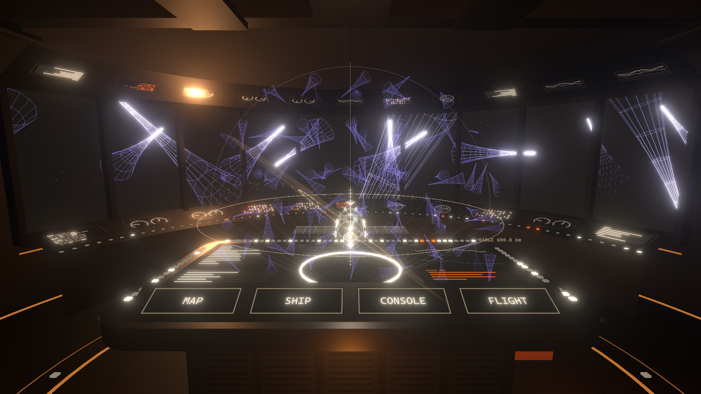
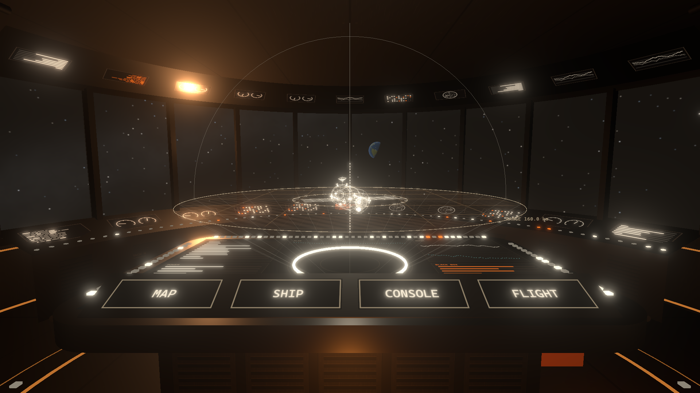
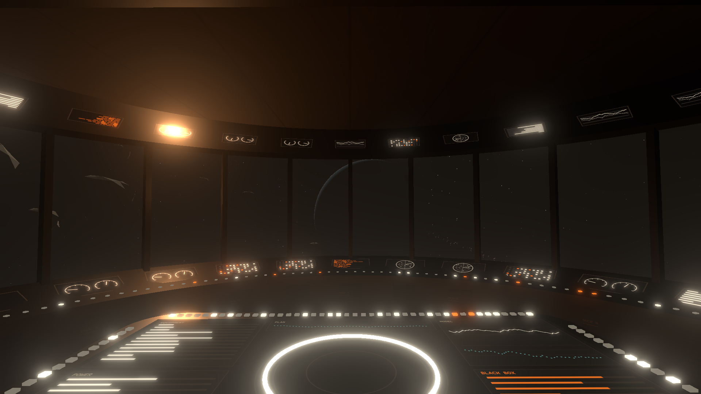
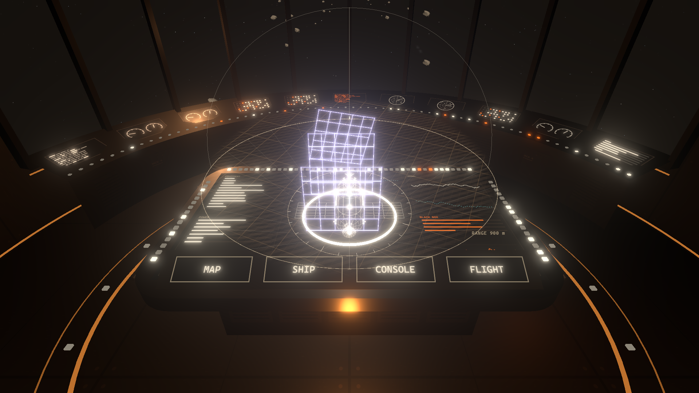

# Handoff: TV — five trailer room shots

Thread: GPT/Codex · Branch: `p3/tr-visuals` · 2026-11-15 (Pacific)

## Delivered

Review draft under A26: each shot still needs the owner's approval in the trailer page. Wells checkpoint: `508480c`; subsequent checkpoints extend this note.

- `src/trailer/rig/`: one scripted RoomView, one WebGL canvas and its CSS label layer, serialized off-screen preparation, recorded-optics interpolation, capture/review tools.
- `src/trailer/scenes/wells/`: real run-0 Garden geometry and optical fixture; prepared window contours and staged FLIGHT reconstruction; display-only yaw after 0.6 s.
- `src/trailer/scenes/console/`: the real opening's Earth, stars and held standing pose, with a staged slowly turning FLIGHT ship and level disc.
- `src/trailer/scenes/slingshot/`: a real played Beta pass, packed optical keyframes and a reproducible command tape; lighter staged hull strain.
- `src/trailer/scenes/lattice/`: the Cathedral's real terminal rock window, its truth-layout FLIGHT diagram staged through 3C's view, and the game's loss animation aligned to 9.0 s.
- `src/view3d/room/RoomView.ts`: **owner-authorized exception**, one additive `renderScriptedFrame(data, shot, time)` beside the opening's scripted-shot method. Applies camera, frame, light, hologram and `sampleLoss` without advancing the room clock. Existing methods, PF renderer setup and 3F region/range code are untouched. The game never calls it.
- `src/view3d/sky/`: **no change needed**. These fixtures keep the sun visible; the existing exposure remains at its initialized daylight target. The staged braid also uses a fixed visible sun. No wall-clock exposure transition enters these shots.

## Review and verification

Run `npm run dev -- --host 127.0.0.1 --port 5191 --strictPort`; open `/src/trailer/?from=4.5` and press Space, or hold `/src/trailer/?still=6.05`.

For reproducible captures, `node src/trailer/rig/browser.mjs` launches **installed Chrome** in a fresh temporary profile, headless with `--force_high_performance_gpu`. It changes no OS preference. Use its printed port in `node src/trailer/rig/review.mjs PORT wells 5.5`. Close that isolated browser through CDP when finished. The flag is also used in [Chromium's dual-GPU tests](https://chromium.googlesource.com/chromium/src/+/3a4f44d71050a78dd3af92e5405d17286c92e93b/testing/buildbot/test_suites.pyl).

[DEMONSTRATED: `npm run check`, 2026-11-15] 1,379 tests passed, one skipped, plus the separate performance test; lint and typecheck passed. Final build and integrated review are recorded below when complete.

Capture resolution is 1536 × 864 CSS at DPR 1.25, canvas 1920 × 1080. Review scripts capture start/middle/end, seek backwards, compare PNG SHA-256, then time five seconds of rendering. The repeat comparison is exact **on the same browser/GPU**; this does not claim identical rasterization across GPUs. Raw frame intervals and errors accompany the stills.

## Wells — 4.8–7.3 s

[Start](tv/wells-start.png) · [Middle](tv/wells-middle.png) · [End](tv/wells-end.png) · [Timing and seek report](tv/wells-review.json)

[DEMONSTRATED: captured fixture] Source build `93b555c35f5deae18f7258013351e974de2fbbda`, `inverse-wells`, run 0, T+1238 s (20:38), no burns. The source field is captured through VX's `createFunnelWindow` and `buildWindowView`. There are 128 selected sites: 100 active, 17 ramping, 11 precursors. No well is invented, moved or reshaped. Their phases and brightness are frozen for the beat; there are no births or flashes.

Reproduce in the isolated dev-game browser: evaluate `scenes/wells/reframe.js` with `node src/trailer/rig/capture.mjs PORT src/trailer/scenes/wells/reframe.js OUTPUT.json`. The script resets only that browser profile's Garden attempt, coasts 1238 exact ticks, and records the fixture. It includes the real and staged eye positions. `capture.js` also records the unshifted game view.

**Every staged element:** the display eye is 400 km forward of the played position; the FLIGHT projection uses the real optical sites' truth geometry because R32 acquisition is absent; its zero-uncertainty duplicate rings are hidden and its theme-opacity wire is clipped to the hologram volume. The trailer refines the same selected sites' contour sampling using 3B's projector (nine stations, sixteen azimuth samples) and VX's native light renderer, avoiding the live producer's 2,048-arc limit. This is a trailer detail increase, not a change to the game's producer. The yaw is an authored suggestion of tail pull, starting at local 0.6 s and reaching about 32° at the cut; it is not a computed force or a change to game attitude. Window and hologram use the same display rotation. Camera framing and held time are editorial.

Compression: **held T+1238 s**; the 2.5 s display yaw runs at 1×. No room-brightness changes.

[DEMONSTRATED: wells-review.json] One canvas, zero console errors, exact repeat image. RTX 4050 / ANGLE D3D11: median 6.1 ms, p95 24.1 ms, worst 48.5 ms; CPU render p95 5.9 ms. The earlier default headless run selected Intel UHD and was substantially slower. **Sustained 60 fps is not yet demonstrated**; do not read the 165-Hz median as a no-hitch claim.

## Console — 23.9–26.2 s

[Start](tv/console-start.png) · [Middle](tv/console-middle.png) · [End](tv/console-end.png) · [Timing and seek report](tv/console-review.json) · Trailer hold: `?still=25.05`

[DEMONSTRATED: console scene and captures] Uses the actual `HOME_SHOT` position, rotation and room level, with `createHomeWindow()` and no lens. No Earth position, radius, texture, light or sky change. **Proposal: held camera**, so the final calm answers the opening. The real FLIGHT disc is level (`headingUp: false`).

**Every staged element:** the ship hologram is visible over Earth; it uses the Garden fixture's real ship configuration, relocated to the display origin with a slow 0.25 rad/s spin derived from `roomMotion`. This is a display composition, not a recorded homeward trajectory. No nearby bodies or fields in the hologram. Held world time; display spin at 1×. No brightness changes or alarm; TR's hard cut remains 26.2 s.

[DEMONSTRATED: console-review.json] One canvas, zero console errors, exact repeat image. RTX 4050: median 6.1 ms, p95 18.1 ms, worst 30.4 ms; CPU render p95 3.7 ms. Sustained-60 gate remains open.

## Slingshot — 2.3–4.8 s

[Start](tv/slingshot-start.png) · [Middle](tv/slingshot-middle.png) · [End](tv/slingshot-end.png) · [Timing and seek report](tv/slingshot-review.json) · Trailer hold: `?still=3.55`

[DEMONSTRATED: played capture, source build `93b555c`] A fresh `gravity-range` run 0 was flown through the full production GameSession/model, using ordinary attitude, configuration and hands-on thrust controls. The approximately 14 m/s prograde burn is centred at 3,960 s; the tape then uses the published real RCS lift at 80,020–80,060 s. At 95,000 s a real RCS attitude command faces Beta's 108,000 s bearing measured in a preceding flown pass. There are no state assignments or object relocations. Every input, its time and the look direction are in fixture provenance.

The shot replays **97,200–117,000 s (27:00–32:30 mission hours) in 2.5 s: 7,920×**. Beta's true apparent radius ranges approximately 8.8–10.0° and its bearing sweeps from −38.5° to +34.8°. Its mostly dark face is the real phase on this route, not an added rim or relighting. The belt rocks and the striated crescent use VX's own optical renderers. The crescent is subtle at this committed source look; approved upstream R54 lighting has not been copied into TV.

Reproduce: evaluate `scenes/slingshot/capture.js` using `rig/capture.mjs` in a disposable dev-game profile, outputting the raw recording to the scene's fixture, then run `node src/trailer/rig/compact.mjs slingshot`. The capture script reads the committed `lookDirection` before replacing the fixture and resets only that profile's Twin Deeps attempt. Raw samples are every 600 s; the committed 2,120,199-byte fixture retains 1,200 s keyframes plus the final 600 s interval, with nine significant digits. Rays and angular sizes interpolate between recorded samples; attitude uses quaternion interpolation. This is an optical edit, not a new simulated orbit. The recorded sun is constant, and the cloud patch count is constant throughout.

**Every staged element:** the forward room camera and continuous half-strength theme-derived loss-like lift/roll. No hologram focus. No brightness changes; the sound cues need no move.

[DEMONSTRATED: slingshot-review.json] One canvas, zero console errors, exact repeat image. RTX 4050: median 6.1 ms, p95 12.2 ms, worst 30.4 ms; CPU render p95 3.3 ms. The few long intervals still prevent a strict no-hitch 60-fps claim.

## Lattice — 7.3–10.3 s

[Start](tv/lattice-start.png) · [Middle](tv/lattice-middle.png) · [End](tv/lattice-end.png) · [Timing and seek report](tv/lattice-review.json) · Trailer hold: `?still=8.8`

[DEMONSTRATED: played capture, source build `93b555c`] `chain-link`, run 0, a fresh attempt coasting with no controls, dt 0.1 s, through real `GameSession.stepTicks(5)`. It reaches a real terminal event at **249.5 s, cause `power`**. The recorded telemetry has destroyed batteries, camera, science processor, forward RCS and other equipment. It is not a fabricated collision event or a win. `capture.js` records the last twenty seconds and the real seeded layout; evaluate it via `rig/capture.mjs`, then `node src/trailer/rig/compact.mjs lattice` to reproduce the packed fixture. The committed fixture is 564,858 bytes.

The terminal optical eye is held while the camera looks down, then tilts up from trailer 8.4 to 9.0 s. The window uses only the real rock optics; no lattice is drawn outside. At **9.0 s**, `sampleLoss(local - 1.7, false)` plays the game's damage shake, room dips and hologram death at **1×**, through its first 1.3 seconds. Its later black cut is never sampled. The alarm comes on at 9.0 and holds. World-time compression: **held terminal frame**, not a compressed twenty-second fly-through.

**Every staged element:** the truth-layout reconstruction (R46 is absent on this source build), its full immediate reveal and zero-uncertainty strands, hiding its unresolved-volume hatch and status labels without claiming measured coverage; the look-down/look-up camera; the editorial placement/hold of the real terminal state at trailer 9.0. The fixture retains the actual loss cause. The scene does not claim the model acquired these strands.

### Exact lighting handoff to TR (R43)

The room level starts at 1. From 9.0 it follows the game's continuous sag `1 - 0.86 × smoothstep(0, 1, (t - 9)/1.5)`. Inside each dip, multiply that sag by **0.06**. These are room-light fractions, not whole-window exposure values; no sky or sun pulse is added.

| Absolute start | Duration | Level at start | Level on recovery |
|---:|---:|---:|---:|
| 9.14 | 0.08 | 0.058735 | 0.949928 |
| 9.60 | 0.10 | 0.041837 | 0.612936 |
| 10.10 | 0.12 | 0.017451 | 0.218711 |

The hologram is off during each dip, returns after the first two and dies permanently at **10.10**. At the 10.3 cut, room light is **0.18178963**, held into the braid. `light.ts` exports `STRIKE`, `DAMAGE_DIPS` (including native levels) and `BRAID_ROOM_LEVEL`. Alarm level is continuously 1 from 9.0 through the braid; no pulses.

[DEMONSTRATED: `light.test.ts`] Counting the room dips **together with** TR's title/braid dips and black transitions gives at most three authored falls and three rises in any closed one-second interval. This schedule test does not replace TR's final rendered-video check of cuts and occupied image area.

[DEMONSTRATED: lattice-review.json] One canvas, zero console errors, exact repeat image **after visiting all four other room shots**. RTX 4050: median 6.1 ms, p95 18.1 ms, worst 30.4 ms; CPU render p95 3.7 ms. Sustained-60 gate remains open.

## Requests outside TV ownership

- Owner: approve each concrete shot under A26; the review draft is not an approval claim.
- TR: register the exact 9.14/9.60/10.10 room dips above in the central flash accounting, without drawing a second page veil over them. TV already applies them through `sampleLoss`; `light.test.ts` checks the combined schedule from TV's owned folder. Strike/failure/alarm audio already aligns at 9.0 s, so no cue move is requested.
- VX/integrator: the owner's approved R54 Twin Deeps and Cathedral arrivals were still an unmerged VX draft when TV began. TV uses this branch's committed sky; no uncommitted region edits were copied. Twin Deeps (Galaxy/warm ivory) and Cathedral (Pair right, Ember Wheel left/pearl) are approved upstream; **Well Garden remains provisional**. Re-review the shots after the approved region work is integrated.
- PF/TR: any renderer-level performance changes remain outside this exception. TV reports full timings rather than changing PF's setup.
