# VX — Art brief follow-through

Branch: `p3/vx-visuals`. Final source: `374bafb` (atlas implementation in `7f43b09`, followed by the Needle's stretched spiral detail). Baseline: `01a0947` (the integrated NIGHT and first VX pass). The earlier pass remains documented in [vx.md](vx.md).

## Delivered

- The Galaxy is a restrained, thin lens with an opaque torn lane, compact bulge and dim garnet knots. Its broad grey wash is gone.
- The Ember Wheel has 250 separate warm rim points, denser on the near edge, plus 65 arm points. These share the field-star buffer, with no extra draw.
- The approved Needle, Hollow and Eye are small fixed landmarks. The atlas also has the Blue Cloud, Pair, Ember and four tiny distant galaxies. There are 15,674 resolved points total, with a quieter, sparse Deep pole. The same fixed seed and directions serve every run.
- Diffuse light still bakes once into the 512-pixel-per-face HDR cubemap. The sky remains two draws: dome and points. It follows the eye without translational parallax.
- The eye adapts over real seconds when `WindowView.sun.visible` changes. Both stars and diffuse sky recover after an occultation; the sun itself stays a small hard disc. No simulation-time animation or twinkling.
- Funnel birth now joins dots from the throat outward, using observed phase, brightness and optical contour depth. The mouth stays dotted while the narrow end becomes continuous. Precursor and active looks remain distinct. Cloud geometry/material is unchanged; the transparent curtain was checked against the quieter sky.

Read from `art/window-references` in the art worktree: `docs/art/vx-brief.md`, `art-bible.md`, `window-views.md`, and the reference selections/library. The bible is authoritative. The three named round-7 comparison files were absent from Downloads during this pass; no visual comparison against those originals is claimed. No reference or generated art image was copied into the repository.

## Verification

- `npm run check`: passes on final source `374bafb`; 132 test files pass, one skipped, 1,264 tests pass, one skipped; the separate performance test also passes. Both browser audits use the final source too.
- `npm run build`: passes. Existing chunk-size and ineffective dynamic-import warnings remain. Main JS grows by 4.33 kB raw / 1.65 kB gzip against the integrated baseline; no image download is added.
- Production opening replay and all three encounter previews: zero `console.error`, browser exceptions, browser log errors, or model errors. [Production audit](vx/art-after-console.json), [baseline audit](vx/art-before-console.json).
- Ten compiled atlas/room fixture captures: zero console or browser errors. Active, dotted precursor and partial birth cases all render; the birth comparison shows the changed joining direction. These are rendering fixtures, not real P03 optics.

The coverage test uses twelve 60-degree full cones on icosahedral directions. Eleven must contain a landmark; the Deep pole is deliberately exempt. A browser GPU readback repeats the test with point stars hidden, so a random bright star cannot pass it. Every non-exempt cone has visible diffuse light; the baseline had six empty cones. This is the brief's sampled check, not proof of every possible narrow camera direction.

The GPU audit also requires at least 75% quiet pixels in each landmark-centred 60-degree view. The Galaxy view improves from 55.8% to 88.1% quiet pixels (maximum channel below 12/255, circular viewport). Its mean maximum channel drops from 19.37 to 5.74/255. Peak diffuse luminance is 23.1% of the measured-line theme colour, under the 30% ceiling. Mean diffuse colour stays at least ΔE76 26.3 from forecast, thrust, velocity, Black Box, caution and warning, above the required 20; colours are compared at equal luminance so darkness cannot pass the hue check by itself. These are atlas inspection renders before the room compositor, not a measurement of every hologram's final bloom. The CPU check sweeps 1,024 headings for the two-major-landmark limit. Star generation is deterministic; exposure is frame-rate independent.

## Performance — release gate still fails

[Portable S15 measurements](vx/art-performance.json), including the integrated baseline and final-source follow-up. The full matrix at `7f43b09` used installed headless Chrome, Intel UHD / ANGLE D3D11, 1366 × 768 at DPR 1, 4× CPU throttling, 10/1 Mbit/s and 40 ms latency. Two eight-second samples per view, at 1× warp; two cold/warm load pairs. The opening-seen marker bypasses the 19.5-second cinematic only in the measurement profile, so cold means cold HTTP cache for a returning player. No VX tests, builds or other browsers ran during measurement. Other host activity was not controlled.

| View | p95, first / second sample (ms) | Worst frame across both (ms) |
|---|---:|---:|
| Room | 30.4 / 24.2 | 109.2 |
| Mission | 6.2 / 6.2 | 24.5 |
| Plan | 6.2 / 6.3 | 54.6 |
| Model | 6.2 / 6.2 | 60.8 |
| Black Box | 6.2 / 6.2 | 30.2 |
| Systems | 6.3 / 6.2 | 78.7 |
| Flight | 24.3 / 24.3 | 54.4 |
| Map | 18.3 / 36.4 | 66.7 |
| Ship | 18.4 / 42.4 | 84.8 |

Cold readiness: **3,443 / 2,130 ms**; interaction paint: **3,570 / 2,271 ms**. One cold load, MAP and SHIP miss the 2.5 s / 33 ms targets. All samples remain at 1×, with no saturation or model errors. The baseline room p95 was 72.7 / 72.8 ms and Flight 175.8 / 66.8 ms; the host was shared, so these are observations, not a controlled speedup claim. The final SHIP profile put its largest named samples in Three's program setup, draw submission and VAO binding; it does not isolate a cause or qualify a real modest laptop.

The final Needle-only bake refinement (`374bafb`) was checked separately with the same cold-load and ROOM/FLIGHT procedure. Cold readiness was **3,824 / 2,586 ms**, interaction paint **3,936 / 2,702 ms**; ROOM p95 **30.5 ms**, FLIGHT **42.4 ms**. No console/model errors or saturation. The release gate remains failed on the final source too. The full nine-view table above is explicitly the pre-refinement source, not relabelled as a final-source run. Raw frame vectors: [baseline](vx/art-before-frames.json.gz), [full matrix](vx/art-after-frames.json.gz), [final refinement](vx/art-final-frames.json.gz).

## Before and after

Same cameras, dimensions and fixtures. The baseline shader/effect sources are loaded from `01a0947`; no image reference is involved. The wide sky shots have a 100.4-degree horizontal view. Oddity details are enlarged to 17.7 degrees horizontally for inspection, not their apparent size in the room.

| View | Before | After |
|---|---|---|
| Actual production Twin Deeps | 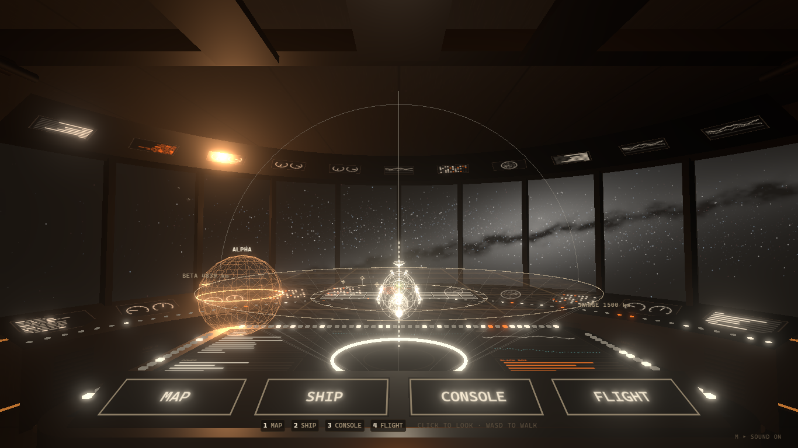 | 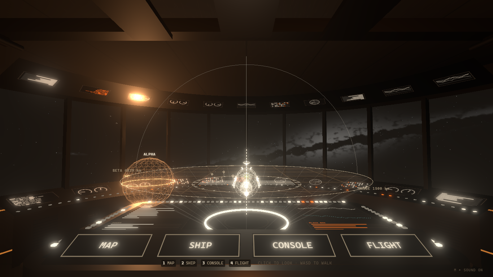 |
| Galaxy | 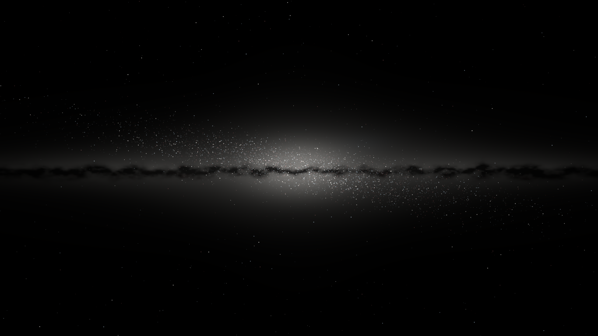 | 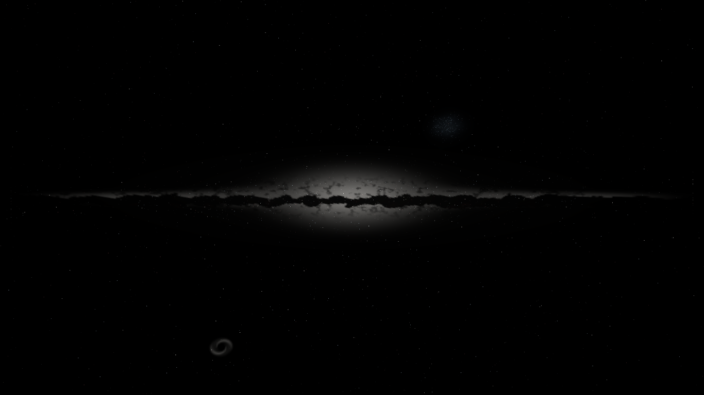 |
| Ember Wheel | 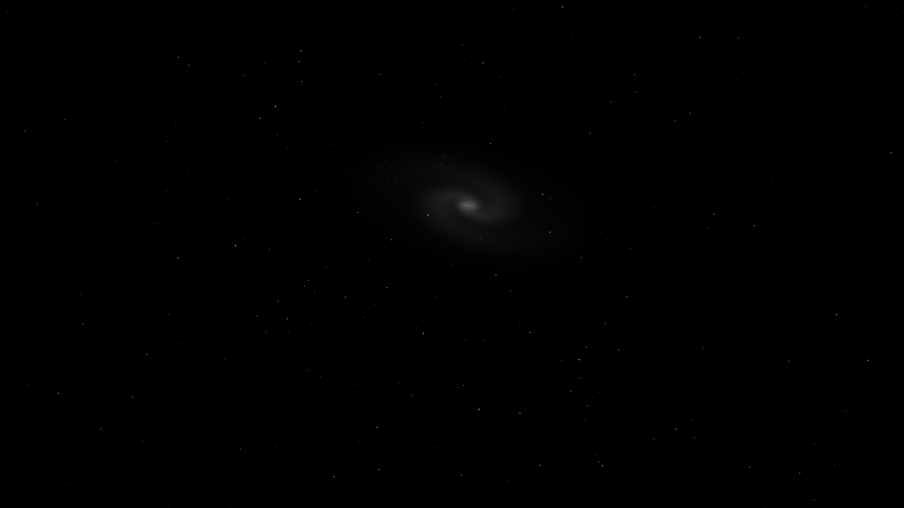 | 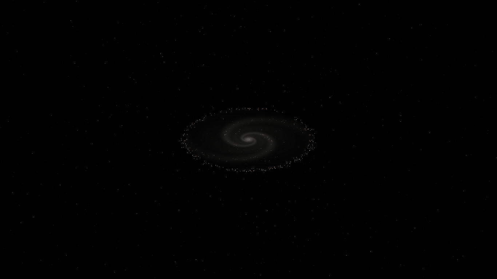 |
| Needle detail | 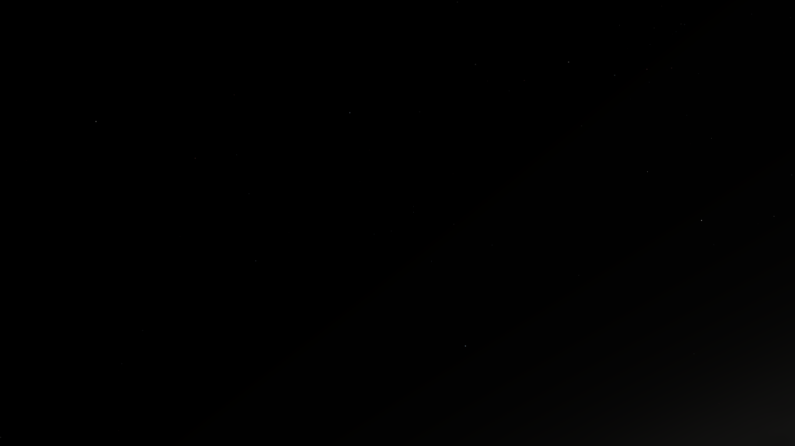 | 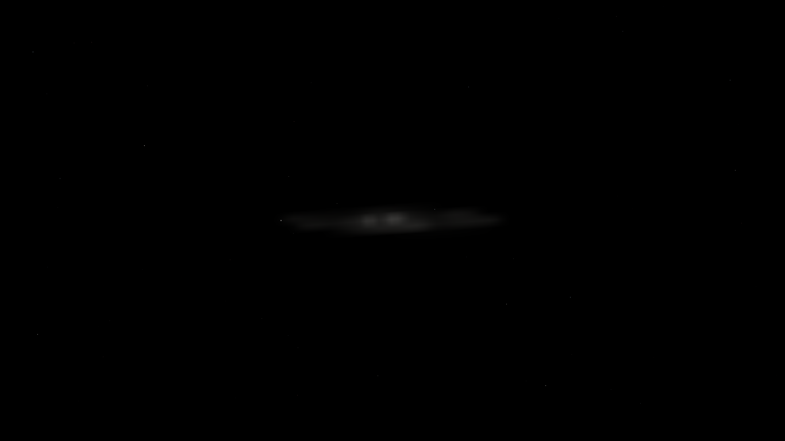 |
| Hollow detail | 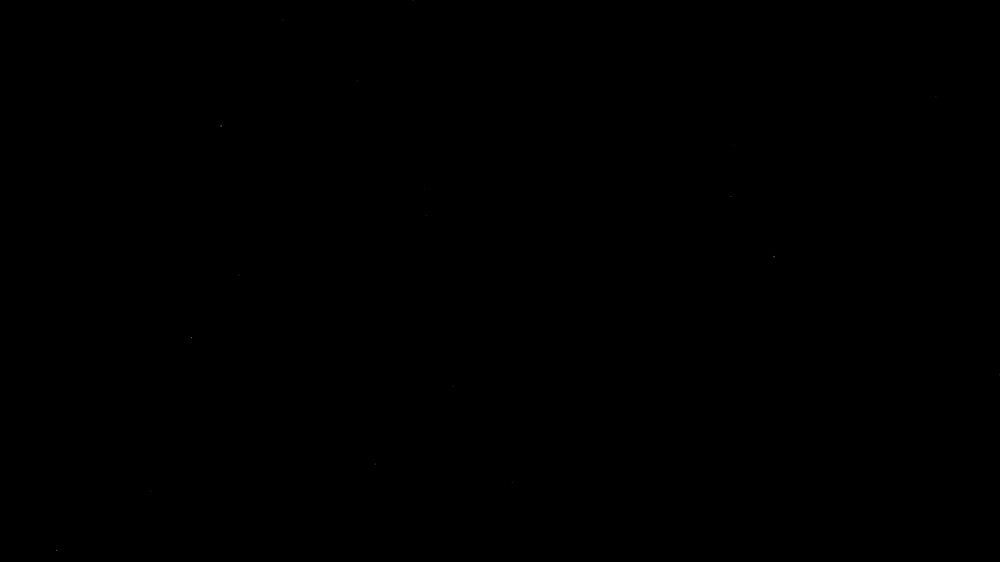 | 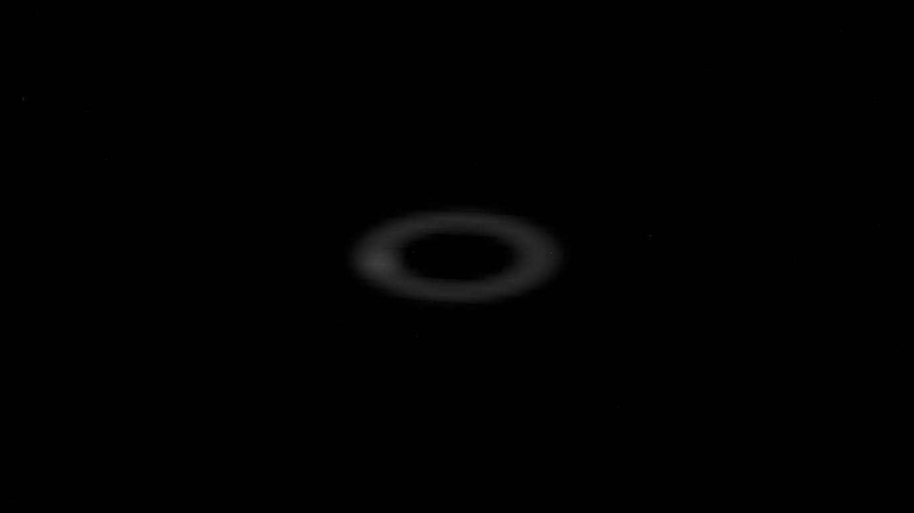 |
| Eye detail |  | 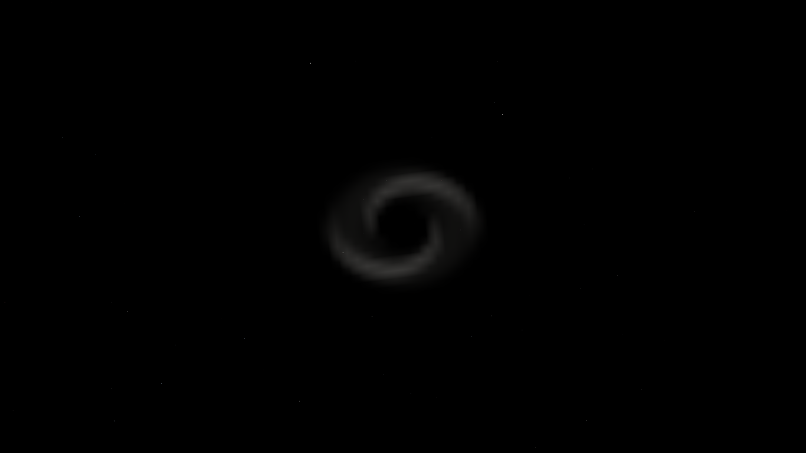 |
| Funnel birth fixture | 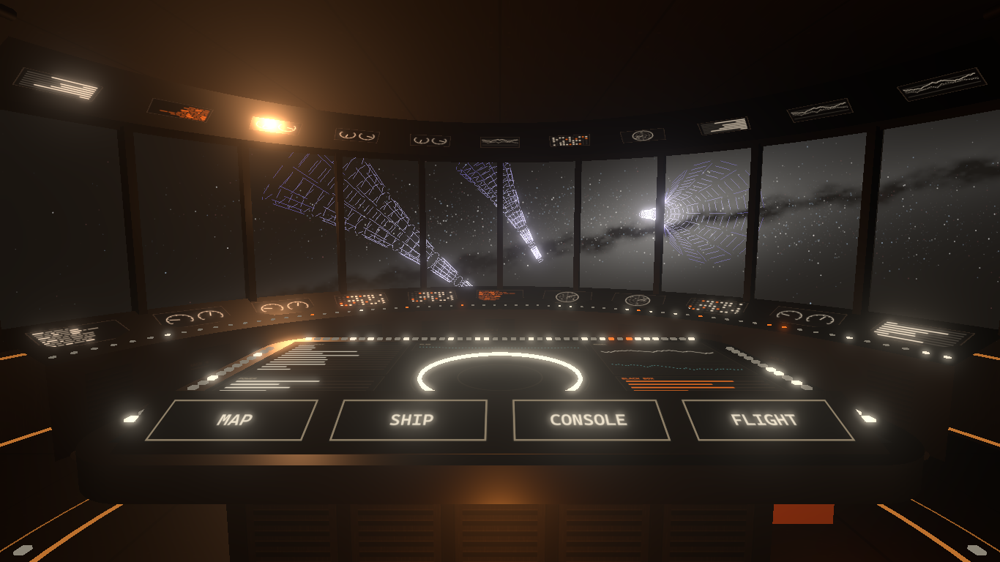 | 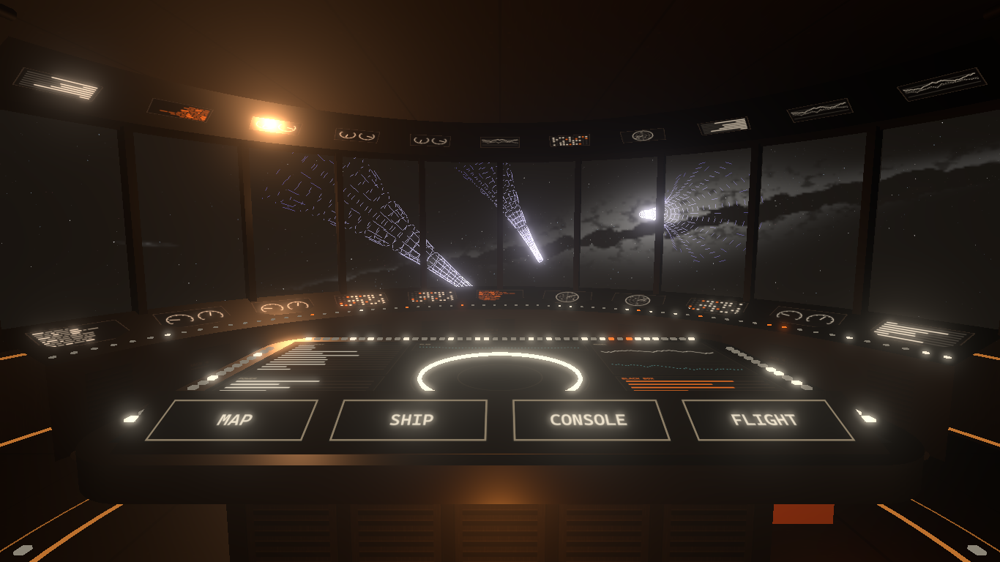 |
| Cloud fixture | 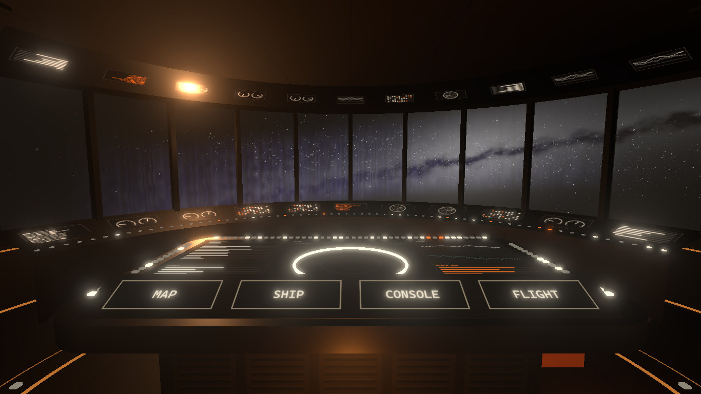 | 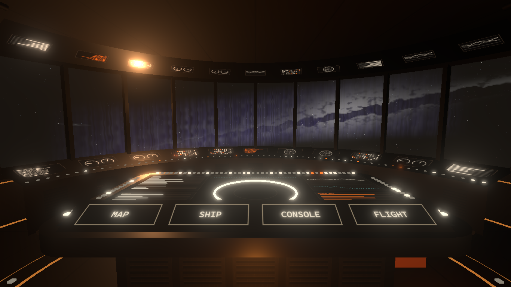 |

The optical fixtures feed synthetic light-only rays into the shipping room renderer. They prove the drawing and wiring, not that a live encounter publishes those rays. [Before audit](vx/art-before-audit.json), [after audit](vx/art-after-audit.json). The cloud fixture's material did not change; the background did.

Other production views: [Well Garden before](vx/art-before-funnels.png) / [after](vx/art-after-funnels.png); [Cathedral before](vx/art-before-cathedral.png) / [after](vx/art-after-cathedral.png). The real Well Garden still has no offered funnels; the Cathedral's lattice stays invisible.

## Integration limits and requests

- **Route framing awaits the expedition owner.** The checked-out game still has three separately loaded encounters (`src/game/encounters.ts`); its chart places the current region at the origin (`src/game/belief/chart.ts`). It has no authored C01 arrival or transit-leg coordinates. Atlas directions are fixed authored sky coordinates, not guessed physical courses. `landmarksInView()` accepts an inertial scene direction for the later leg check. The Eye is low beside the Galaxy, but its exact C01 framing is not yet qualified. The proposed leg table, eclipse of N01, and C06 hairline cannot be demonstrated in live transit yet.
- **P03 optics remain absent.** The Well Garden's real funnel producer still needs to publish the optical channel. No fake funnels, route bodies, openings or hidden lattice were inserted. Distant births and the approach to the Garden wait for that data.
- **Collision silhouettes remain the integrator's decision.** This pass does not turn spherical collision bodies into slabs or overhangs. The hooded galaxy remains unapproved and unbuilt.
- **Performance is a gate, not an art setting.** The S15 result and any remaining failure are recorded with the final measurements; a real modest-laptop check still belongs to release qualification.

## Reproduction

From the VX worktree: `npm run check`, `npm run build`, then `node docs/handoffs/vx/capture.mjs art-after`. The production capture audits errors through an opening replay and all three live encounter previews. `node docs/handoffs/vx/capture-art.mjs before` / `after` compile the isolated atlas and optical fixtures. Rebuild the normal app after fixture capture before measuring its bundle.

`node docs/handoffs/vx/measure-art.mjs --run vx-art-after --views room,mission,plan,model,blackbox,systems,flight,map,ship --repeats 2 --seconds 8 --load-repeats 2 --profiles modest --warps 1 --no-build` runs S15 against clean committed source. The final refinement uses `--run vx-art-final --views room,flight --repeats 1` with the other flags unchanged. The wrapper adds only an opening-seen marker to its temporary browser profile; it does not modify game behavior or timing. Raw profiles stay uncommitted; `summarize-art.mjs` selects portable measurements and rejects host paths.
