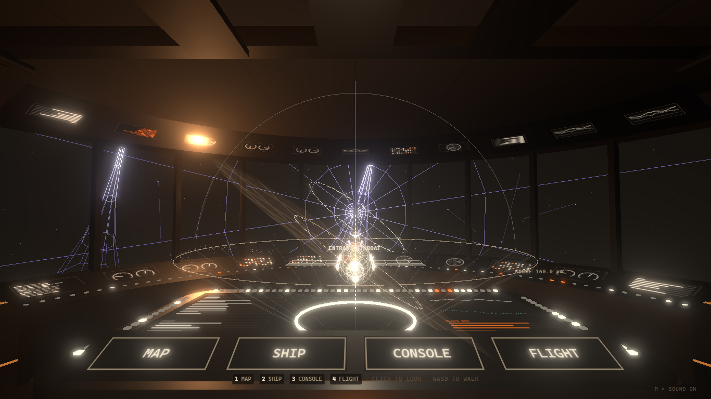
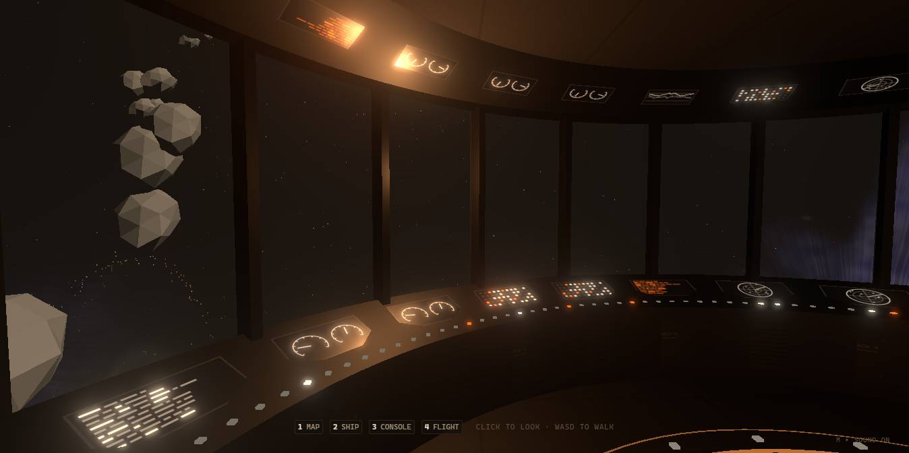

# VX — Mission views and live Garden light

Branch: `p3/vx-visuals`. Source checkpoint: `e326823`. Merged `main` first in `002cbde`; that merge is the before-image baseline. Read A26's morning preamble, NIGHT's judge run, and the merged ART brief/bible. No reference images, downloads or generated textures were added.

## What the whole flight looks like

The window uses the current optical observation throughout flight. There are no timed scenery substitutions, enlarged landmarks or invented rocks.

| Region / stage | Player's view |
| --- | --- |
| Twin Deeps arrival and Alpha approach | The fixed sky gives heading; Alpha grows at its reported angular radius. Its unlit face removes stars, while the lit surface and warm edge follow the supplied sun. Fine regolith variation resolves near the terminator, with no atmospheric halo. |
| Alpha pass and transfer | The limb sweeps across the fixed background as the ship translates and turns. Walking inside the room no longer shifts celestial directions. A sphere now uses `sin(angularRadius)` for its radius, fixing the old close-pass inflation from `tan`. |
| Beta pass and belt | Beta uses the same exact angular sizing. Supplied rocks grow from small facets into nearby irregular silhouettes, lit by the actual sun; their meshes stay inside the supplied enclosing radius. The existing optical cloud patches show the striated violet crescent beyond the rocks. No full ring is substituted. |
| Departure | Bodies and rocks shrink with their reported apparent sizes; the crescent recedes with its optical patches and the fixed sky becomes dominant again. This behavior is continuous, not triggered by mission completion. A successful departure was **not** reached in the live walkthrough below. |
| Well Garden arrival, weaving flight and throat approach | Nearby wells resolve into violet rings and meridians, rising sharply toward the bright throat. The shape, perspective, clipping and changing apparent size come from 3B's projection at the actual eye. Distant support becomes faint threads and throat rims. |
| Precursors and births | The scheduled 900-second precursor is a faint dotted contour. Only committed activation starts a birth; a veto removes the light. Brightness continues into the actual 120-second ramp, and dots join from the throat toward the mouth. There is no simulation-time flicker. |
| Unseen Cathedral | A quiet field of sunlit rocks and black unlit faces against the sky. The lattice remains invisible to the unaided eye, including during flight. |

## Scoped integration

- New truth-side `src/game/funnel-window.ts` calls `projectFunnelOptics` with actual ship position, committed activation, current time and `visibleWellIntervals` for cone/opaque-sphere clipping. Output is typed `WindowFunnel`: unit rays, colour coordinate, observed phase and brightness. No catalogue coordinates, dimensions, axes or ranges cross into the renderer.
- The only change to 2F's `funnels.ts` is the import and one factory call in `withFunnels`. The producer installs the hook on the original provider as well as the returned adapter: the session reads the former, while the truth stepper retains the latter. Installation is idempotent across attempts.
- Source culling examines the whole catalogue, then retains at most **128** visible candidates and **2,048 emitted arcs**. Nearby contours get the detail first. Parsed specs and repeated observations of the same committed world are cached. The existing single-draw, double-buffered renderer remains bounded.
- Corrected VX's reversed colour coordinate: 3B's `depth = 0` is the throat. A regression assertion now checks that it is brighter than the mouth. Another checks large supplied body angles through a close pass. No test or tolerance was loosened.
- `RoomView.ts`, the rest of 3F's paths, and content/catalogue geometry were not edited. This completes the **window** producer in R50; it does not claim that R32's powered camera/inference wiring is complete.

## Production screenshots

Matched production arrivals, same camera framing and viewport. The final Garden arrival offers 128 sites and draws **114 funnels / 1,951 arcs** after the window-wall cull. The before build has no Garden optical entries.

| Region | Before | After |
| --- | --- | --- |
| Twin Deeps | [Before](vx/mission-before-deep-sky.png) | [After](vx/mission-after-deep-sky.png) |
| Well Garden | [Before](vx/mission-before-funnels.png) | [After](vx/mission-after-funnels.png) |
| Unseen Cathedral | [Before](vx/mission-before-cathedral.png) | [After](vx/mission-after-cathedral.png) |

Actual production flight, using NIGHT's existing real-key/mouse judge driver:

- [Airless body during a Twin Deeps coast](vx/mission-twin-bodies.jpg).
- [Beta pass and belt, about T+29:48](vx/mission-twin-beta-belt.jpg), and [the crescent beside the belt](vx/mission-twin-crescent.jpg).
- [Cathedral rock field during flight](vx/mission-cathedral-flight.jpg).
- [Garden birth during actual flight](vx/mission-garden-birth.jpg). At T+20:38 the final producer reported **91 active, 15 ramping and 9 precursor** entries. A 30-second upward RCS correction avoided the coasting throat hazard; no physics or optical data was replaced for the capture.

The live Twin Deeps run used the published 14 m/s prograde burn at 3,960 seconds. It reached the Beta/belt view, then ended in loss amid the belt at T+31:04. No completed-departure screenshot is claimed. The Garden's coasting attempt also demonstrated its throat hazard; this is visual work, not an admission claim for a successful route through either preview.

## Verification

- `npm run check`: **1,361 tests passed**, one existing skipped; the separate existing performance test passed. Typecheck and lint passed.
- `npm run build`: passed. Existing large-bundle and ineffective-dynamic-import warnings remain.
- Final production arrivals: **zero console/runtime errors**, no model errors, all three regions in room mode. [Before audit](vx/mission-before-console.json), [after audit](vx/mission-after-console.json).
- Live judge walkthroughs also reported no console errors. The walkthrough deliberately kept the existing forecast/warp alerts and loss behavior.
- Reused existing screenshot, judge-run and S15 tools; no new evidence suite or admission matrix.

Existing S15 spot check, same native profile, 1366×768, 1× warp, one four-second sample per view:

| Frame p95 | Before (`002cbde` overlay) | After (`e326823`) |
| --- | ---: | ---: |
| ROOM | 42.5 ms | 24.3 ms |
| FLIGHT | 36.5 ms | 18.4 ms |

Neither measured number worsened. Both runs advanced at 1 ship second per wall second, with zero saturation and zero errors. These are short observations on an uncontrolled shared host, **not** proof of a speedup or a new S15 release-gate pass, and they cover S15's default Twin Deeps scene rather than the Garden. [Portable results](vx/mission-s15.json), [baseline source overlay](vx/mission-baseline.patch). The existing wrapper now accepts `VX_PREVIEW_PORT` so it can leave another thread's preview server alone.

The preceding sky work and its wider S15 release-gate limits remain in [the art pass](vx-art.md).
