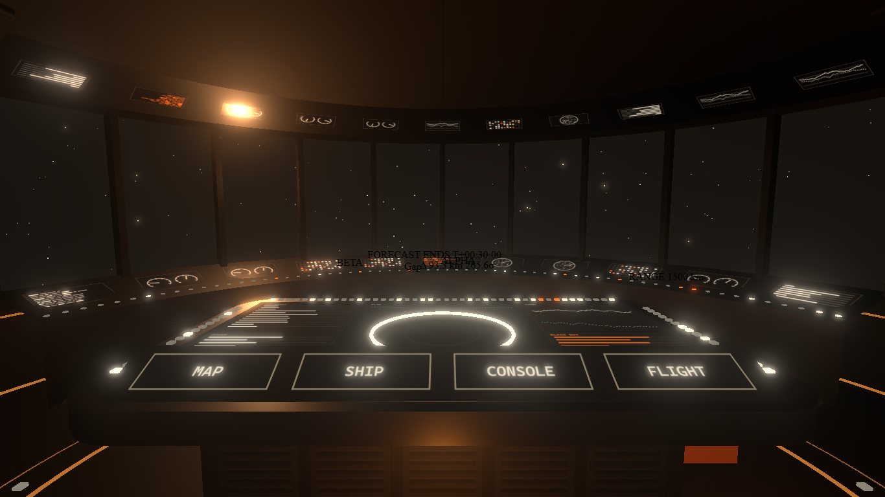
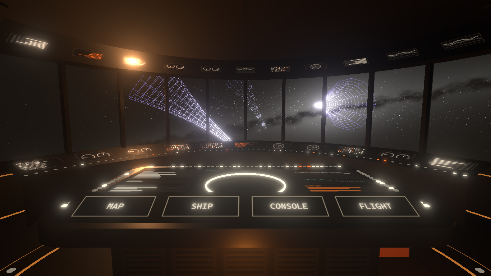
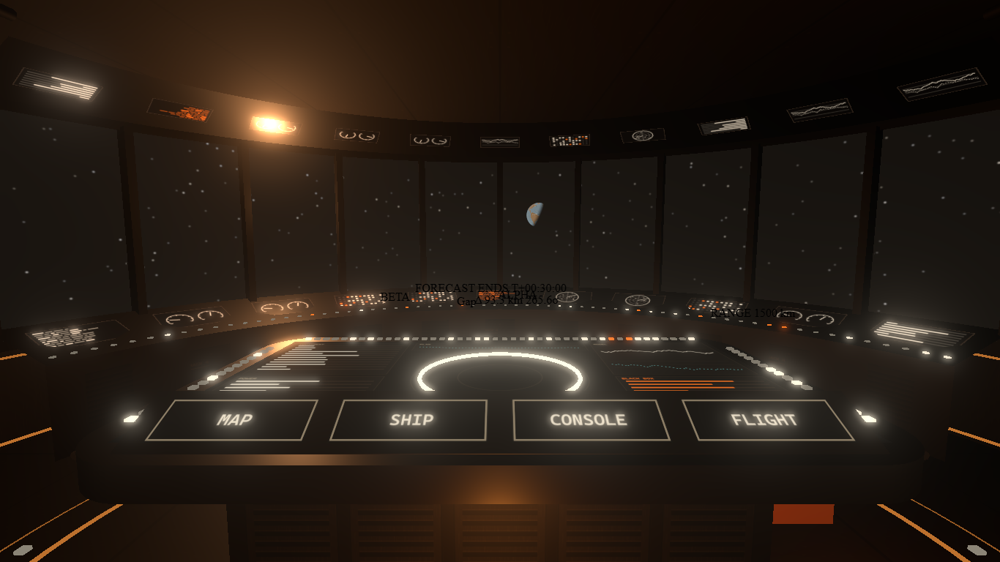
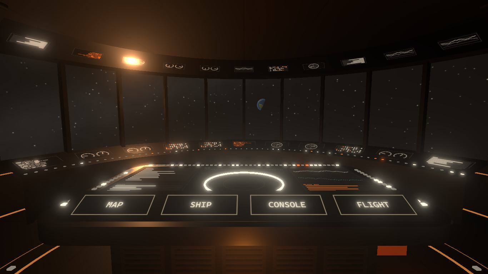
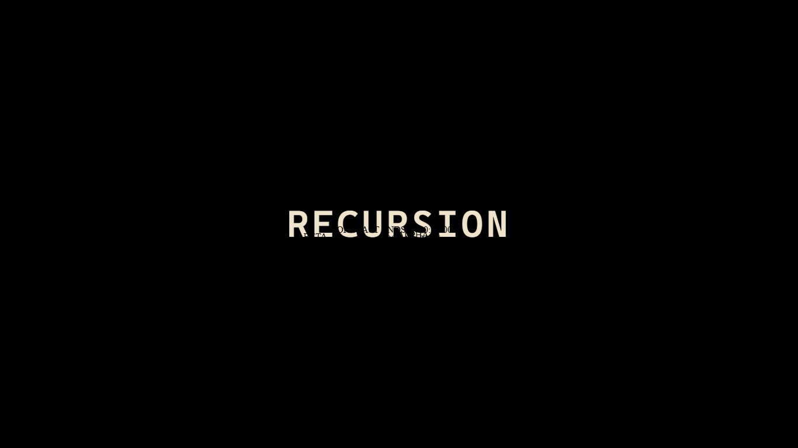

# Handoff: VX — Window and sky visuals

Thread: GPT/Codex · Branch: `p3/vx-visuals` · Worktree: `.worktrees/vx` · Date: 2026-11-15 (Pacific).

## Delivered

- `src/view3d/sky/`: a fixed celestial atlas with an edge-on galaxy, torn dust lane, dim emission knots, a cold star cloud, the tilted Ember Wheel, seeded point stars with a steep brightness distribution, and a small sun driven by `WindowView.sun`. No downloaded or generated images. The sky follows the eye without walking parallax and turns with the ship.
- `src/view3d/fx/`: pooled cloud-bank sprites, luminous funnel contours with white throats, and static dotted precursors that join continuously as reported birth brightness increases. All geometry comes from optical directions; no true ranges, radiation intensity, field catalogue, or guessed forces enter the renderer.
- `outside.ts`: mounts the sky and both optical effects. Bridges R38's typed `funnel` entry to the earlier `inverse-well` plugin envelope; consumes `cloud-bank` patches directly. Custom opening scenery replaces the entire arrival sky. Missing channels retire their visuals.
- `RoomView.ts`: two window-only calls keep the dome centred on the live/scripted camera. No changes to controls, loss sequences, lighting, or the other overnight lanes.
- `src/view3d/opening/`: blue ocean, muted land, polar ice, white clouds, directional terminator and a thin blue atmospheric limb. Earth's S23 size (2.92°) and phase (83.24°), OP's lens trajectory, sequence timings and title opacity schedule remain. Earth is sampled on the original ray so the lens never duplicates it. The title gets wider tracking and a responsive, lighter weight using existing theme tokens.

The ART files are not yet on this branch's main base. This pass read ART's current `art-bible.md`, `selections.md` and `window-prompts.md` in its worktree. It follows the selected edge-on Galaxy, second spiral, white-to-violet funnels, and translucent cloud curtain. The universe atlas stays fixed across runs as the art bible requires; its seeded stars never twinkle.

## Verification

- `npm run check`: typecheck, lint, 1,238 passing tests / one skipped, plus the separate passing performance test. Re-run after the final rendering refinements is recorded below when complete.
- `npm run build`: passes. Existing Vite chunk-size / ineffective-dynamic-import warnings remain.
- `node docs/handoffs/vx/capture.mjs after`: serves the actual production build on 4186; audits browser exceptions, `console.error`, browser log errors, and the model error in Twin Deeps, Well Garden and Unseen Cathedral. [Console evidence](vx/after-console.json).
- `node docs/handoffs/vx/capture-optics.mjs before` and `after`: compile the actual room and optical renderers with controlled light-only fixtures on 4187. The before variant loads the three replaced renderers from `0ee3d1c`; the after variant uses this branch. It covers active/end-on/precursor funnels, clouds, Earth, lens and title; title fits 360 px. [Fixture console evidence](vx/after-optics-console.json).
- Five integration tests in `src/view3d/fx/light.test.ts` exercise the promoted optical contract, stale observations, precursor joining, invalid/absent cloud patches, complete scenery replacement/disposal, and eye-centred placement under a rotated parent. The existing funnel/window and opening tests also pass.

Performance measurements with S15's modest profile follow in the final checkpoint. Port 4175 is reserved for that runner; nothing was installed.

## Before and after

Actual production app, same 1366 × 768 viewport and camera position. The default Twin Deeps view shows the deep sky and live cloud-bank channel behind the flight display.

| Before | After |
|---|---|
|  |  |

Controlled optical fixtures below use the production-compiled room and window renderer, with the hologram hidden to inspect the window. **These are synthetic optical inputs, not evidence that the Well Garden publishes its optics.**

| Subject | Before | After |
|---|---|---|
| Deep field |  |  |
| Typed funnel channel |  |  |
| Cloud curtain |  |  |
| Home / Earth |  |  |
| Title |  |  |

## Claims and limits

- [DEMONSTRATED: production browser audit] All three region URLs load without a console error or model fault. Twin Deeps supplies 1,118 optical cloud patches at its initial frame. The window consumes them; the lattice remains invisible to the unaided eye.
- [DEMONSTRATED: controlled optical fixture] All three supplied funnels render (side-on, end-on, precursor), with 1,116 segments in the chosen test view. The old typed-channel input displayed none. This is a rendering test, not a navigation or admission result.
- [ASSUMED] The atlas orientation and local theme-derived optical palette are presentation choices. Nothing in the sky adds a simulated nearby body, force or collision shape. `sky/style.ts` collects the local extensions for adoption by the theme owner.
- [FICTIONAL] Violet light from funnels and radiation clouds follows the approved art direction, not ordinary radiation physics. The renderer does not reveal dose or a safe route.
- [DEMONSTRATED: tests and code] The funnel renderer keeps 2D's bounded double-buffer scheduler and 60,000-segment ceiling. Its decimation joins only connected optical segments, never gaps removed by upstream occlusion clipping. Clouds use one draw, a fixed 4,096-patch buffer, rear-hemisphere culling and no time-dependent shimmer. Neither effect accelerates with warp.

## Requests outside VX's ownership

1. **3B / game integration: publish Well Garden optical data (R31/R38).** On the merged base, `createInverseWells()` does not supply `EncounterSetup.window`, and the actual production Well Garden supplies no `WindowView.fields`. `projectFunnelOptics` exists but has no caller there. The window integration is now complete for `WindowFunnel` entries (`kind: 'funnel'`, schema `well-optical-v1`, current `observedAt`, visible arcs, phase and brightness). Connect the truth-side producer with occlusion, lifecycle and source LOD; do not send catalogue geometry to VX or fabricate funnels in `outside.ts`. This is the remaining reason actual Well Garden screenshots have no funnels.
2. **NIGHT owns the opening mount and R44.** This branch's app still does not mount the opening. The opening images above verify its renderer independently. Keep NIGHT's once-per-browser gate and fully still reduced-motion sky / plain fade when merging. VX adds no motion or flash cadence.
3. **Theme owner:** adopt `sky/style.ts` optical colour derivatives and the title treatment if desired. No shared theme file was changed.

## Merge notes

Keep NIGHT's `RoomView.ts` changes and VX's two `outside.followEye(...)` calls. Use VX's `outside.ts` and `sky/`, `fx/`, `opening/` updates together. 3B can reuse `funnelLightMaterial()` for an optical preview; it expects `color`, `along` and `coverage` attributes. The instrument view remains 3B's lane.

The preview entry is not imported by the application and does not ship in the normal build. Rebuild the normal app after the fixture capture before running S15. All committed evidence uses repository-relative paths.
