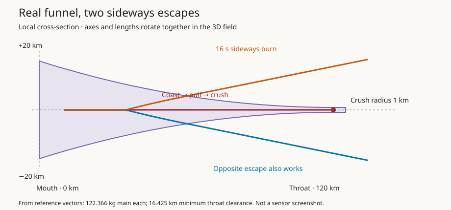

# S22 — a visible forest of real funnels

**Recommend A19's visible, physically active funnels:** 120 km long, 20 km mouth
radius, 1 km crushing throat; a smooth side/cap transition; a gravity-like axial
pull; and reversal of axial propulsion with both sideways directions preserved.
Place **2,601** separated funnels through a volume roughly **1,419 × 2,699 ×
2,699 km**, with independent axes and 650 reserved sites that appear in three
precursor-led waves. These are [ASSUMED] content choices, not owner decisions.

**The requested unconditional fuel wall is not established and cannot follow
from finite compact funnels alone.** The reference supplies a finite-thrust
exterior route costing **726.769 kg**, essentially S16's counterexample, even
around this larger field. It now takes **51.519 days** at 1 m/s. A 35 m/s detour
costs **2,592.737 kg** and takes **35.904 hours**, versus about **122.366 kg** and
**6.4–6.6 hours** for either nominal crossing. A 125 m/s detour would require
**6,984.559 kg**, beyond the tank. These are [DEMONSTRATED: `generate.py`]
translation calculations; they are not an exhaustive route optimum or a real
ship endurance certificate. See [bypass.md](bypass.md) before claiming containment.

This study follows main `b3ecb2d` and the revised S22 prompt/A19. It changes no
`src/`, shared contracts, creative brief, decisions or region pages. Physics,
appearance and numerical thresholds below are proposals. The owner chooses;
the integrator records decisions and merges this branch.

## Deliverables

| File | Use |
| --- | --- |
| [physics.md](physics.md) | Exact geometry, pull, reflection, sensing, crush, escape limits and wrong-belief recovery |
| [appearance.md](appearance.md) | Deterministic births and veto; window light; camera evidence; belief-only FLIGHT and Hinge |
| [bypass.md](bypass.md) | Finite slow/fast exterior flights, conditional lower bound, and why a global fuel wall fails |
| [seeds-and-performance.md](seeds-and-performance.md) | Catalogue, rejection denominators, certificates, spatial indexing and measured kernel cost |
| [implementation.md](implementation.md) | Reuse map against S5/S16/3B, exact owner requests, code estimates, integration gates and owner questions |
| [Reference usage](../../../tools/studies/s22/README.md) | Commands, inputs, units, tolerances and numerical limits |
| [vectors.json](../../../tools/studies/s22/vectors.json) | All eight requested reference cases plus negative controls and convergence |
| [field.json](../../../tools/studies/s22/field.json) | Nominal full field, axes, birth times and placement rotation |
| [seeds.json](../../../tools/studies/s22/seeds.json) | All 32 raw candidates, failures and admitted flight certificates |
| [Handoff](../../handoffs/s22.md) | Merge/verification summary and requests outside study ownership |

## What the reference demonstrates

[DEMONSTRATED: `tools/studies/s22/generate.py`] The two nominal routes start
10 km down the entrance funnel at 35 m/s. The player coasts to 600 s, burns
sideways for 16 s, then coasts through the wider field. The Python controls are
**delivered inertial forces**, not attitude commands or an automatic game planner.

| Result | Negative sideways route | Positive sideways route |
| --- | ---: | ---: |
| Exit time | 23,179.902 s | 23,911.993 s |
| Main propellant | 122.366 kg | 122.366 kg |
| Minimum whole-ship throat clearance bound | 16.425 km | 16.425 km |
| Funnels whose influence is encountered | 0, 1572 | 0, 1606 |
| Includes a new appearance | Site 1572, born at 2,400 s | No; second site begins active |

[DEMONSTRATED: same reference] The initial coast ends in a crush at 1,764.190 s.
An instinctive outward 30 s burn advances the crush to 1,468.976 s. A forecast
with the correct pull but ordinary thrust is wrong by 1.189 km at 440 s, leaving
1,028.976 s before loss. A recovery after a 240 s pointing allowance escapes for
412.985 kg total. A real pointing/RCS/sensor/thermal loop has **not** been run.

[ASSUMED] Against A15's **1,000 kg main / 30 kg RCS** Garden budget, the nominal
crossing leaves 877.634 kg main; retaining 200 kg for further corrections leaves
677.634 kg above that reserve. The demonstrated mistaken-burn recovery leaves
587.015 kg. The independent translational reference uses the conservative wet
mass of 30,374 kg; it neither refills a lighter arriving ship nor certifies all
mass/damage/attitude combinations. Main use is measured; RCS allowance is not.

[DEMONSTRATED: catalogue] Seven of 32 proposed states pass this study's preparation,
warning/recovery and four crossing-control checks. Worst admitted crossing
clearance is 6.198 km; worst warning lead 603.300 s; worst local recovery clearance
5.978 km. All reserved volumes have a geometric non-overlap proof independent of
the seed. **These are mechanics candidates, not release-approved seeds.**

## Scope and recommended decision

[ASSUMED] Build this ambitious field as the next **prototype**, with the physical
pull/reversal lesson, clearly visible funnels, acquired geometry, wave precursors
and a protected lateral recovery. Keep the cheaper slow exterior route as a
regression test. Do not describe the field as impassable from arbitrary upstream
positions: disconnected narrow funnels leave both exterior space and interior
gaps, and an already nearby outgoing ship can bypass it at negligible cost.

[ASSUMED] If the owner requires a global resource barrier, the integrator must
specify an additional real physical constraint and certify it: for example an
authored moving transfer opportunity or a measured, unavoidable energy deficit
on every slow exterior route. Neither is approved by this study. A universal
countdown, artificial fuel-per-distance charge, hidden boundary, moving funnel
that chases the ship, or rule-adoption gate would contradict the existing design.

[ASSUMED] A smaller prototype can use a **9 × 5 × 5 = 225-site** crop with the
same physics and birth rules. It loses the large apparent expanse, the stated
exterior travel scale and these full-field certificates; rerun the catalogue and
fly it again. An isolated funnel is suitable for Hinge/controls testing but does
not satisfy the owner's large-field direction. Retain the 2,601-site reference
as the preferred target; graphics visibility and level of detail should reduce
rendering cost before reducing physical content.
